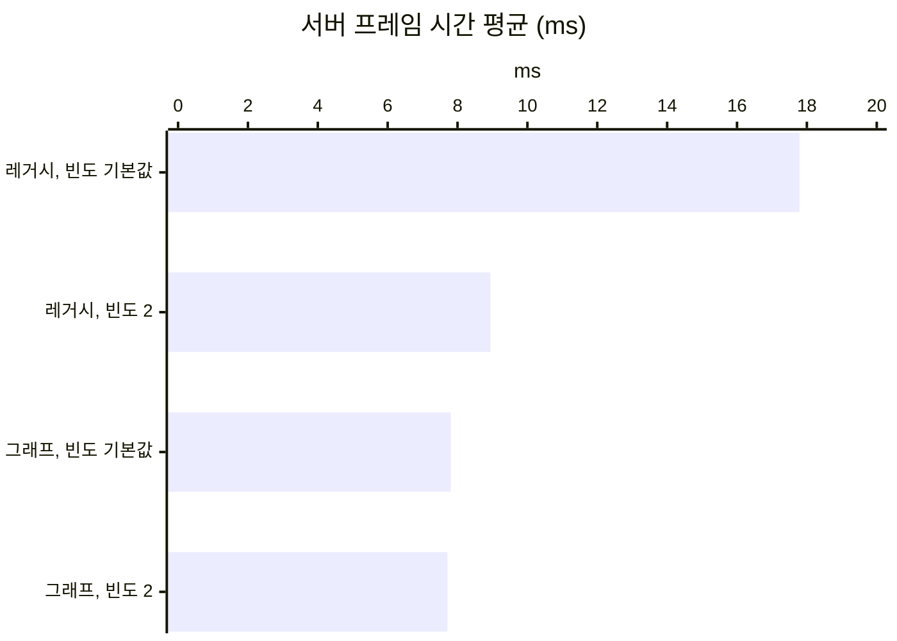

# 14. 레거시 리플리케이션을 Replication Graph로 바꾸기

## 요약

Replication Graph로 바꾸자 서버 프레임 시간이 13.8% 줄었다. 대신 연결당 송신 대역폭이 8.8% 늘었다.

[자원 노드의 Net Update Frequency 낮추기](../08-node-update-frequency/README.md)는 먼 자원 노드를 확인하는 횟수를 줄였다. 그래도 서버는 그 자원 노드를 프레임마다 순회했다. 그래서 서버의 리플리케이션 방식을 레거시에서 Replication Graph로 바꿨다. 레거시는 엔진의 기본 리플리케이션 방식이다.

같은 출발점에서는 그래프가 빈도를 낮추는 방법보다 더 줄였다. 그래프에서는 빈도를 낮출 필요가 없었다.

| 지표 | 지금 구성 | 그래프로 바꾼 뒤 | 변화 |
| --- | --- | --- | --- |
| 서버 프레임 시간 평균 | 8.94ms | 7.71ms | -13.8% |
| 리플리케이션 시간 | 3.96ms | 2.92ms | -26.1% |
| 연결당 송신 대역폭 | 10,100바이트/초 | 11,000바이트/초 | +8.8% |
| 1번 클라이언트에 존재하는 자원 노드 | 176개 | 380개 | +204개 |


서버가 1번 클라이언트에게 보낼지 프레임마다 확인하는 자원 노드를 그렸다. 왼쪽 레거시는 150m 밖의 주황 점까지 프레임마다 확인한다. 오른쪽 그래프는 1번 클라이언트가 서 있는 파란 칸의 목록만 확인한다. 칸 경계와 거리는 실제 값이고, 점의 위치는 같은 밀도의 예시다.

서버 프레임 시간은 서버가 한 프레임을 처리한 시간이다. 리플리케이션 시간은 그 가운데 액터를 확인하고 보낸 시간이다. 연결은 서버와 클라이언트 하나 사이의 통신이다. 수치는 구성마다 세 번 실행한 중앙값이다. 실행별 값, 계산식, 엔진 소스 위치는 [측정 기록](measurements.md)에 있다.

## 문제: 서버가 먼 자원 노드를 프레임마다 순회한다

지금 구성에서도 서버는 보낼 일이 없는 먼 자원 노드를 프레임마다 순회한다. 서버는 액터를 다음 세 단계로 보낸다.

1. 서버가 활성 목록을 순회해 Consider List를 만든다. 활성 목록은 서버가 보낼지 확인해야 하는 액터의 목록이다. Consider List는 이번 프레임에 확인할 액터의 목록이다.
2. 서버가 클라이언트마다 Consider List의 액터를 확인한다. 150m 거리 검사와 우선순위 정렬을 한다.
3. 서버가 확인을 통과한 액터를 보낸다.

자원 노드는 모든 클라이언트에서 Dormant 상태가 되어야 활성 목록에서 빠진다. Dormant 상태는 서버가 깨우기 전까지 그 액터를 확인하지 않는 상태다. 플레이어 무리에서 150m 밖의 자원 노드는 어느 클라이언트에도 보낸 적이 없다. 그래서 Dormant 상태가 되지 못하고 활성 목록에 남는다.

[직전 글](../08-node-update-frequency/README.md)은 이 자원 노드를 16프레임에 한 번만 확인하게 했다. 그래도 서버는 확인할 차례인지 보려고 자원 노드를 프레임마다 순회한다.

| 빈도를 낮춘 뒤의 리플리케이션 시간(프레임당) | 시간 |
| --- | ---: |
| ① 활성 목록을 순회해 Consider List 만들기 | 0.959ms |
| ② 클라이언트마다 거리 검사하고 정렬하기 | 0.845ms |
| ③ 확인을 통과한 액터를 보내기 | 1.87ms |

①과 ②는 보낼지 확인하는 일이다. 이 둘을 합친 시간이 보내는 일인 ③과 비슷하다. ①의 약 3분의 2는 차례가 아닌 자원 노드를 순회하는 시간이다.

## 원리: 클라이언트가 있는 칸의 목록만 확인한다

**Replication Graph**는 엔진 플러그인이다. 서버가 보낼지 확인할 액터를 고르는 방법을 바꾼다. 액터를 보내는 방법은 레거시와 같다.

그래프는 다음 순서로 액터를 고른다.

1. 서버가 맵을 100m 칸으로 나눈다. 칸의 크기는 엔진의 예제 그래프와 같다.
2. 서버가 액터를 칸의 목록에 넣는다. 액터에서 150m 안에 걸치는 칸에 모두 넣는다.
3. 서버가 프레임마다 클라이언트가 있는 칸의 목록만 가져온다.
4. 서버가 그 목록의 액터를 확인한다. 150m 밖의 액터는 보내지 않는다.

칸에는 Dormant 상태의 자원 노드 목록이 클라이언트마다 따로 있다. 서버는 자원 노드를 한 번 보내면 그 목록에서 지운다. 그래서 받은 자원 노드는 다시 확인하지 않는다. 다른 칸의 자원 노드는 아예 확인하지 않는다.

엔진의 예제 그래프에서 두 가지를 바꿨다.

- 움직이는 액터를 매 프레임 확인한다. 예제는 3프레임에 한 번 확인한다.
- 액터를 보내는 간격을 레거시의 평균 간격에 맞췄다. NPC는 4프레임, 자원 노드는 16프레임이다.

보내는 횟수가 달라지면 효과가 섞이기 때문이다.

캐릭터의 간격은 맞추지 못했다. 레거시는 캐릭터를 평균 1.3프레임마다 확인한다. 그래프의 간격은 정수 프레임이라서 캐릭터를 매 프레임 보낸다.

**예상.** 레거시는 프레임마다 활성 목록의 5,272개를 순회한다. 그래프는 클라이언트마다 약 75개를 확인한다고 계산된다. 따라서 ①과 ②의 시간 1.80ms가 크게 줄 것이다. 캐릭터를 보내는 횟수는 약 1.3배로 늘 것이다.

## 적용: 실행 인자로 그래프를 만든다

```diff
 // Source/DSOptLab/DSOptLab.cpp
+	// -LabReplicationGraph일 때만 서버의 GameNetDriver에 그래프를 만든다.
+	UReplicationDriver::CreateReplicationDriverDelegate().BindLambda(
+		[](UNetDriver* ForNetDriver, const FURL& URL, UWorld* World) -> UReplicationDriver*
+		{
+			if (World && ForNetDriver && ForNetDriver->NetDriverName == NAME_GameNetDriver)
+			{
+				return NewObject<ULabReplicationGraph>(GetTransientPackage());
+			}
+			return nullptr;
+		});

 // Source/DSOptLab/LabReplicationGraph.cpp
+	// 움직이는 액터를 매 프레임 확인하고, 간격은 클래스마다 정한 프레임 수가 정한다.
+	UReplicationGraphNode_ActorListFrequencyBuckets::DefaultSettings.NumBuckets = 1;
+	GridNode = CreateNewNode<UReplicationGraphNode_GridSpatialization2D>();
+	GridNode->CellSize = 10000.f; // 100m
+
+	// 레거시의 평균 간격: (틱 ÷ 빈도) + 1프레임
+	const int32 Frames = FMath::RoundToInt(TickRate / NetUpdateFrequency + 1.f);
```

액터를 목록에 넣는 규칙은 엔진의 예제 그래프와 같다.

- 모든 클라이언트에 보내는 액터는 공통 목록에 넣는다.
- 소유한 클라이언트에만 보내는 액터는 그 클라이언트의 목록에 넣는다.
- 나머지 액터는 칸의 목록에 넣는다.

구성은 실행 인자로 바꾼다.

| 구성 | 더한 실행 인자 |
| --- | --- |
| 레거시, 빈도 기본값 | 없음 |
| 레거시, 빈도 2(지금 구성) | `-NodeUpdateFrequency 2` |
| 그래프, 빈도 기본값 | `-ReplicationGraph` |
| 그래프, 빈도 2 | `-ReplicationGraph -NodeUpdateFrequency 2` |
| 그래프, trickle 끔 | `-ReplicationGraph -RepGraphNoTrickle -NodeUpdateFrequency 2` |

모든 구성은 [NPC 이동을 필요한 비트만 담은 구조체로 보내기](../12-npc-move-netserialize/README.md)의 나머지 인자를 그대로 쓴다. 위의 네 구성을 세 번씩 연달아 쟀다. trickle을 끈 구성은 지금 구성, 그래프와 함께 따로 쟀다. 이 시점의 코드는 태그 [`post-14-replication-graph`](https://github.com/hon454/ue-dedicated-server-optimization-lab/tree/post-14-replication-graph)에 있다.

## 결과

### 같은 출발점에서 그래프가 더 줄였다

같은 출발점에서 그래프는 빈도를 낮추는 방법보다 서버 프레임 시간을 1.14ms 더 줄였다.

| 구성 | 서버 프레임 시간 평균 | 리플리케이션 시간 |
| --- | ---: | ---: |
| 레거시, 빈도 기본값 | 17.8ms | 12.7ms |
| 레거시, 빈도 2(지금 구성) | 8.94ms | 3.96ms |
| 그래프, 빈도 기본값 | 7.81ms | 2.95ms |
| 그래프, 빈도 2 | 7.71ms | 2.92ms |



출발점은 레거시에 자원 노드의 빈도를 기본값으로 둔 구성이다. 자원 노드의 빈도를 2로 낮추면 8.94ms가 됐다. 그래프로 바꾸면 7.81ms가 됐다.

그래프에서는 빈도를 2로 낮춰도 차이가 구별되지 않았다. 서버가 Dormant 상태가 된 자원 노드를 다시 확인하지 않기 때문으로 본다.

### 확인하는 일은 줄고 보내는 일은 늘었다

그래프는 확인하는 시간을 절반 넘게 줄였지만 보내는 시간은 늘렸다. 지금 구성과 빈도 2의 그래프를 비교했다.

- **확인하는 일**: 2.45ms에서 1.14ms로 줄었다. 남은 시간은 그래프가 칸의 목록을 가져오고 움직이는 액터의 칸을 옮기는 데 쓴다.
- **보내는 일**: 1.51ms에서 1.79ms로 늘었다. 캐릭터를 더 자주 보낸 시간이 들어 있다. 그래프가 액터를 보낼 때마다 더 하는 일도 들어 있다.

### 늘어난 대역폭은 캐릭터 몫이다

늘어난 송신 대역폭은 대부분 캐릭터 데이터다. 한 클라이언트에 보낸 캐릭터 데이터는 초당 3,080바이트에서 3,880바이트가 됐다. 늘어난 액터 데이터의 77%다. 나머지는 캐릭터 데이터마다 붙는 머리 정보다. 자원 노드 데이터는 초당 2바이트로 같았다.

> **trickle: 그래프는 150m 밖의 Dormant 자원 노드도 보낸다**
>
> 그래프에서는 클라이언트의 자원 노드가 176개에서 380개로 늘었다. 원인은 엔진의 trickle 동작이다.
>
> 1. 150m 밖의 자원 노드는 거리 검사를 통과하지 못한다. 그래서 Dormant 상태가 되지 못한다.
> 2. 이 자원 노드는 칸의 목록에 남는다. 서버는 이 목록을 프레임마다 다시 확인한다.
> 3. trickle은 이 목록을 비운다. 서버가 남은 자원 노드를 프레임마다 하나씩 거리와 상관없이 보낸다.
> 4. 받은 자원 노드는 Dormant 상태가 된다. 서버는 그 자원 노드를 목록에서 지운다.
>
> 콘솔 변수 `Net.RepGraph.TrickleDistCullOnDormancyNodes`를 0으로 두면 trickle이 꺼진다.
>
> | 레거시 | 그래프 | 그래프, trickle 끔 |
> | --- | --- | --- |
> |  |  |  |
> | 자원 노드 176개 | 380개 | 176개 |
>
> trickle을 끄면 클라이언트의 자원 노드는 레거시와 같은 176개다. 대신 서버 프레임 시간이 7.64ms에서 8.04ms로 늘었다. 그래도 함께 잰 지금 구성의 8.83ms보다 짧다. 송신 대역폭은 같았다. trickle은 클라이언트 메모리를 써서 서버 시간을 줄이는 동작이다.
>
> 그래프는 보낼 액터를 고르는 방법만 바꾼다. 그래서 보내는 액터와 횟수가 같으면 송신량도 같다([Replication Graph 정리 글](https://hon454.github.io/posts/unreal-engine-replication-graph/)). trickle은 보내는 자원 노드를 늘렸지만 측정 구간의 송신량은 바꾸지 않았다. 송신량을 바꾼 것은 캐릭터를 보내는 횟수였다.

### 화면 속 NPC는 그대로다

화면 속 NPC의 위치 오차와 지연은 네 구성에서 구별되지 않았다. 그래프도 NPC를 레거시와 같은 간격으로 보냈다.

## 배운 것과 한계

- **활성 목록에서 빼려면 목록의 구조를 바꿔야 한다.** 빈도를 낮추면 ②에서는 빠지지만 ①은 활성 목록을 계속 순회한다. 그래프는 클라이언트가 있는 칸의 목록만 가져와서 ①을 없앴다.
- **그래프는 확인하는 시간을 줄이고 보내는 시간을 늘린다.** 이 테스트베드에서는 확인하는 시간이 보내는 시간만큼 컸다. 그래서 서버 프레임 시간이 13.8% 줄었다. 보내는 시간이 대부분인 구성에서는 이득이 작다고 추정한다.
- **그래프의 간격은 정수 프레임이다.** 레거시의 평균 1.3프레임은 정수로 맞출 수 없다. 자주 보내는 액터는 간격을 따로 정해야 한다. 이 측정은 플레이어가 한곳에 모인 배치만 다룬다.

측정 환경의 한계는 [테스트베드와 측정 방법](../00-testbed/README.md)의 "한계"에 있다.

**다음 글.** 엔진에는 리플리케이션 방식이 하나 더 있다. Iris는 Replication Graph와 함께 쓸 수 없다. 다음 글은 같은 시나리오를 Iris로 바꿔 레거시 구성과 비교한다.
