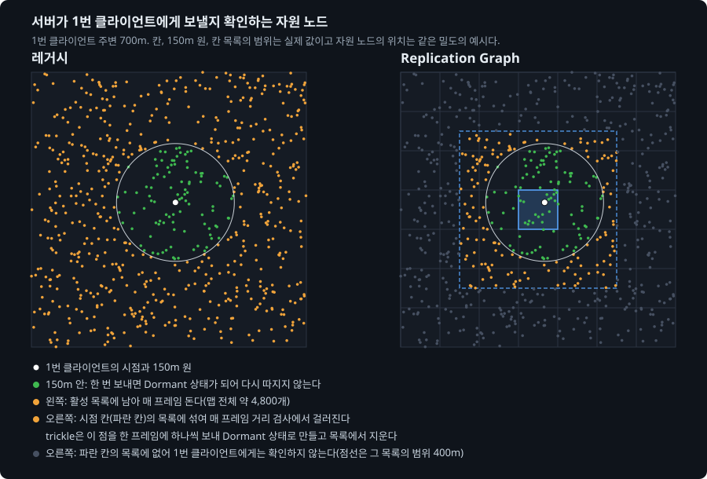
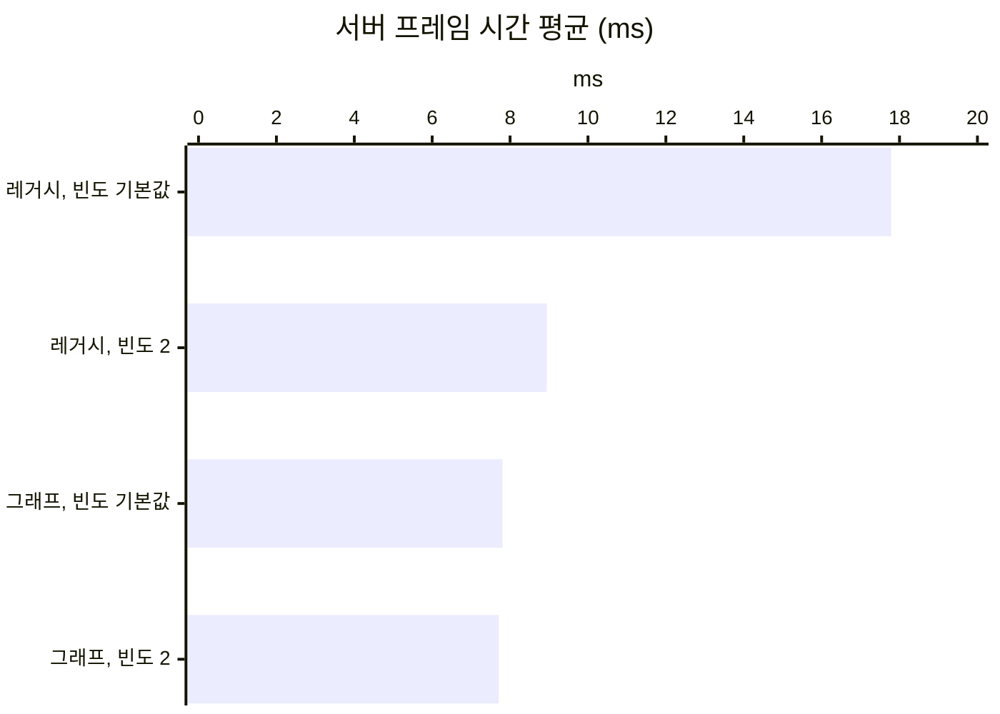

# 14. 레거시 리플리케이션을 Replication Graph로 바꾸기

## 요약

레거시 리플리케이션을 Replication Graph로 바꾸자 서버 프레임 시간이 13.8% 줄었다. 레거시는 엔진의 기본 리플리케이션 방식이다. Replication Graph는 서버가 보낼 액터를 고르는 방법을 바꾸는 엔진 플러그인이다. 아래에서는 그래프라고 줄여 쓴다. 서버 프레임 시간은 서버가 한 프레임을 처리한 시간이다.

대신 연결당 송신 대역폭이 8.83% 늘었다. 연결은 서버와 클라이언트 하나 사이의 통신이다. 그래프에서는 자원 노드의 Net Update Frequency를 낮출 필요가 없었다. Net Update Frequency는 서버가 액터를 확인하는 빈도다.

| 지표 | 지금 구성 | 그래프로 바꾼 뒤 | 변화 |
| --- | --- | --- | --- |
| 서버 프레임 시간 평균 | 8.94ms | 7.71ms | -13.8% |
| 리플리케이션 시간 | 3.96ms | 2.92ms | -26.1% |
| 연결당 송신 대역폭 | 10,100바이트/초 | 11,000바이트/초 | +8.83% |
| 1번 클라이언트에 존재하는 자원 노드 | 176개 | 380개 | +204개 |



왼쪽 레거시는 150m 밖의 주황 점까지 프레임마다 확인한다. 오른쪽 그래프는 1번 클라이언트가 서 있는 파란 칸의 목록만 확인한다. 칸은 그래프가 맵을 나눈 100m 사각형이다.

리플리케이션 시간은 서버 프레임 시간 가운데 액터를 확인하고 보낸 시간이다. 수치는 구성마다 세 번 실행한 중앙값이다. 실행별 값, 계산식, 엔진 소스 위치는 [측정 기록](measurements.md)에 있다.

## 문제: 서버가 먼 자원 노드를 프레임마다 순회한다

지금 구성에서도 서버는 보낼 일이 없는 먼 자원 노드를 프레임마다 순회한다. 레거시는 액터를 다음 세 단계로 보낸다.

1. 서버가 활성 목록을 순회해 Consider List를 만든다. 활성 목록은 서버가 보낼지 확인해야 하는 액터의 목록이다. Consider List는 이번 프레임에 확인할 액터의 목록이다.
2. 서버가 클라이언트마다 Consider List의 액터를 확인한다. 150m 거리 검사와 우선순위 정렬을 한다.
3. 서버가 확인을 통과한 액터를 보낸다.

150m 밖의 자원 노드는 활성 목록에서 빠지지 못한다. 자원 노드는 모든 클라이언트에서 Dormant 상태가 되어야 활성 목록에서 빠진다. Dormant 상태는 서버가 깨우기 전까지 그 액터를 확인하지 않는 상태다. 150m 밖의 자원 노드는 어느 클라이언트에도 보낸 적이 없다. 그래서 Dormant 상태가 되지 못한다.

빈도를 낮춰도 서버는 이 자원 노드를 프레임마다 순회한다. [자원 노드의 Net Update Frequency 낮추기](../08-node-update-frequency/README.md)는 이 자원 노드를 16프레임에 한 번만 확인하게 했다. 그래도 서버는 확인할 차례인지 보려고 1단계에서 활성 목록을 순회한다. 아래 표는 그 글의 적용 후 구성에서 잰 값이다.

| 단계(프레임당) | 시간 |
| --- | ---: |
| 1단계: 활성 목록을 순회해 Consider List 만들기 | 0.959ms |
| 2단계: 클라이언트마다 거리 검사하고 정렬하기 | 0.845ms |
| 3단계: 확인을 통과한 액터를 보내기 | 1.87ms |

확인하는 일이 보내는 일만큼 시간이 든다. 1단계와 2단계가 확인하는 일이다. 3단계가 보내는 일이다.

## 원리: 클라이언트가 있는 칸의 목록만 확인한다

그래프는 클라이언트가 있는 칸의 목록만 확인한다. 액터를 보내는 방법은 레거시와 같다. 그래프는 다음 순서로 확인할 액터를 고른다.

1. 서버가 맵을 100m 칸으로 나눈다. 칸의 크기는 엔진에 들어 있는 예제 그래프(`UBasicReplicationGraph`)와 같다.
2. 서버가 액터를 칸의 목록에 넣는다. 액터에서 150m 안에 걸치는 칸에 모두 넣는다.
3. 서버가 프레임마다 클라이언트가 있는 칸의 목록만 가져온다.
4. 서버가 그 목록의 액터를 확인한다. 150m 밖의 액터는 보내지 않는다.

받은 자원 노드는 다시 확인하지 않는다. 칸에는 Dormant 상태의 자원 노드를 담는 목록이 클라이언트마다 따로 있다. 서버는 자원 노드를 한 번 보내면 그 목록에서 지운다. 다른 칸의 자원 노드는 아예 확인하지 않는다.

확인하는 횟수는 레거시와 같게 맞췄다. 횟수가 달라지면 그래프의 효과와 섞인다. 예제 그래프에서 두 가지를 바꿨다.

- 움직이는 액터를 매 프레임 확인한다. 예제는 3프레임에 한 번 확인한다.
- 액터를 확인하는 간격을 레거시의 평균 간격에 맞췄다. NPC는 4프레임, 자원 노드는 16프레임이다.

캐릭터의 간격은 맞추지 못했다. 레거시는 캐릭터를 평균 1.3프레임마다 확인한다. 그래프의 간격은 정수 프레임이라서 캐릭터를 매 프레임 확인한다.

**예상.** 1단계와 2단계의 시간 1.80ms가 크게 줄 것이다. 계산하면 그래프는 클라이언트마다 약 75개를 확인한다. 대신 캐릭터를 보내는 횟수가 약 1.3배로 늘 것이다.

## 적용: 실행 인자로 그래프를 만든다

```diff
 // Source/DSOptLab/DSOptLab.cpp
+	// -LabReplicationGraph일 때만 서버의 GameNetDriver에 그래프를 만든다.
+	UReplicationDriver::CreateReplicationDriverDelegate().BindLambda(
+		[](UNetDriver* ForNetDriver, const FURL& URL, UWorld* World) -> UReplicationDriver*
+		{
+			if (World && ForNetDriver && ForNetDriver->NetDriverName == NAME_GameNetDriver)
+			{
+				return NewObject<ULabReplicationGraph>(GetTransientPackage());
+			}
+			return nullptr;
+		});

 // Source/DSOptLab/LabReplicationGraph.cpp
+	// 움직이는 액터를 매 프레임 확인하고, 간격은 클래스마다 정한 프레임 수가 정한다.
+	UReplicationGraphNode_ActorListFrequencyBuckets::DefaultSettings.NumBuckets = 1;
+	GridNode = CreateNewNode<UReplicationGraphNode_GridSpatialization2D>();
+	GridNode->CellSize = 10000.f; // 100m
+
+	// 레거시의 평균 간격: (틱 ÷ 빈도) + 1프레임
+	const int32 Frames = FMath::RoundToInt(TickRate / NetUpdateFrequency + 1.f);
```

액터를 목록에 넣는 규칙은 예제 그래프와 같다. 표의 인자는 측정 스크립트(`Scripts/run-scenario.ps1`)의 인자다.

| 구성 | 더한 실행 인자 |
| --- | --- |
| 레거시, 빈도 기본값 | 없음 |
| 레거시, 빈도 2(지금 구성) | `-NodeUpdateFrequency 2` |
| 그래프, 빈도 기본값 | `-ReplicationGraph` |
| 그래프, 빈도 2 | `-ReplicationGraph -NodeUpdateFrequency 2` |
| 그래프, trickle 끔 | `-ReplicationGraph -RepGraphNoTrickle -NodeUpdateFrequency 2` |

모든 구성은 [NPC 이동을 필요한 비트만 담은 구조체로 보내기](../12-npc-move-netserialize/README.md)의 나머지 인자를 그대로 쓴다. 위의 네 구성을 세 번씩 연달아 쟀다. trickle을 끈 구성은 지금 구성, 그래프와 함께 따로 쟀다. 이 시점의 코드는 태그 [`post-14-replication-graph`](https://github.com/hon454/ue-dedicated-server-optimization-lab/tree/post-14-replication-graph)에 있다.

## 결과: 확인하는 시간이 줄어 서버 프레임 시간이 13.8% 줄었다

### 예상과 실제

| 항목 | 예상 | 실제 |
| --- | --- | --- |
| 확인하는 일(프레임당) | 1.80ms의 대부분이 준다 | 2.45ms에서 1.14ms로 줄었다 |
| 캐릭터를 보내는 횟수 | 약 1.3배 | 1.29배 |
| 연결당 송신 대역폭 | 는다 | 8.83% 늘었다 |

실제의 확인하는 일은 예상의 기준보다 넓다. 리플리케이션 시간에서 액터별 시간을 뺀 값이라서 1단계와 2단계 밖의 일도 들어 있다.

### 같은 출발점에서 그래프가 1.14ms 더 줄였다

같은 출발점에서 그래프는 빈도를 낮추는 방법보다 서버 프레임 시간을 1.14ms 더 줄였다.

| 구성 | 서버 프레임 시간 평균 | 리플리케이션 시간 |
| --- | ---: | ---: |
| 레거시, 빈도 기본값 | 17.8ms | 12.7ms |
| 레거시, 빈도 2(지금 구성) | 8.94ms | 3.96ms |
| 그래프, 빈도 기본값 | 7.81ms | 2.95ms |
| 그래프, 빈도 2 | 7.71ms | 2.92ms |



자원 노드의 빈도를 2로 낮추면 8.94ms가 됐다. 그래프로 바꾸면 7.81ms가 됐다.

그래프에서는 빈도를 2로 낮춰도 차이가 구별되지 않았다. 서버가 Dormant 상태가 된 자원 노드를 다시 확인하지 않기 때문이라고 추정한다.

### 확인하는 일은 줄고 보내는 일은 늘었다

그래프는 확인하는 시간을 절반 넘게 줄였다. 대신 보내는 시간은 늘었다.

- **확인하는 일**: 2.45ms에서 1.14ms로 줄었다. 남은 시간은 그래프가 칸의 목록을 가져오는 시간이다. 움직이는 액터의 칸을 옮기는 시간도 들어 있다.
- **보내는 일**: 1.51ms에서 1.79ms로 늘었다. 캐릭터를 더 자주 보낸 시간이 들어 있다. 그래프가 액터를 보낼 때마다 더 하는 일도 들어 있다.

### 늘어난 대역폭은 캐릭터 몫이다

늘어난 연결당 송신 대역폭은 대부분 캐릭터 데이터다. 한 클라이언트에 보낸 캐릭터 데이터는 초당 3,080바이트에서 3,880바이트가 됐다. 늘어난 액터 데이터의 77.4%다. 나머지는 캐릭터 데이터마다 붙는 머리 정보다. 자원 노드 데이터는 초당 1.9바이트로 같았다.

> **trickle: 그래프는 150m 밖의 Dormant 자원 노드도 보낸다**
>
> 그래프에서는 1번 클라이언트에 존재하는 자원 노드가 176개에서 380개로 늘었다. trickle은 서버가 확인하는 목록을 비우려고 먼 자원 노드를 보내는 동작이다.
>
> 1. 150m 밖의 자원 노드는 거리 검사를 통과하지 못한다. 그래서 Dormant 상태가 되지 못한다.
> 2. 이 자원 노드는 칸의 목록에 남는다. 서버는 이 목록을 프레임마다 다시 확인한다.
> 3. 서버가 남은 자원 노드를 프레임마다 하나씩 거리와 상관없이 보낸다.
> 4. 받은 자원 노드는 Dormant 상태가 된다. 서버는 그 자원 노드를 목록에서 지운다.
>
> 콘솔 변수 `Net.RepGraph.TrickleDistCullOnDormancyNodes`를 0으로 두면 trickle이 꺼진다.
>
> | 레거시 | 그래프 | 그래프, trickle 끔 |
> | --- | --- | --- |
> |  |  |  |
> | 자원 노드 176개 | 380개 | 176개 |
>
> trickle은 클라이언트 메모리를 써서 서버 시간을 줄인다. trickle을 끄면 1번 클라이언트의 자원 노드는 레거시와 같은 176개다. 대신 서버 프레임 시간이 7.64ms에서 8.04ms로 늘었다.
>
> trickle은 측정 구간의 연결당 송신 대역폭을 바꾸지 않았다. 그래프는 보낼 액터를 고르는 방법만 바꾼다. 그래서 보내는 액터와 횟수가 같으면 연결당 송신 대역폭도 같다([Replication Graph 정리 글](https://hon454.github.io/posts/unreal-engine-replication-graph/)). 이 테스트베드에서 대역폭을 바꾼 것은 캐릭터를 보내는 횟수였다.

### 화면 속 NPC는 그대로다

화면 속 NPC의 움직임을 재는 두 지표(표시 위치 오차, 표시 지연)는 네 구성에서 구별되지 않았다. 그래프도 NPC를 레거시와 같은 간격으로 확인했다.

## 배운 것과 한계

- **활성 목록에서 빼려면 목록의 구조를 바꿔야 한다.** 빈도를 낮추면 자원 노드가 2단계에서 빠진다. 그래도 서버는 1단계에서 활성 목록을 계속 순회한다. 그래프는 클라이언트가 있는 칸의 목록만 가져와서 1단계를 없앴다.
- **그래프의 이득은 확인하는 시간의 크기에 달렸다.** 이 테스트베드에서는 확인하는 시간이 보내는 시간만큼 컸다. 보내는 시간이 대부분인 구성에서는 이득이 작다고 추정한다.
- **그래프의 간격은 정수 프레임이다.** 레거시의 평균 1.3프레임은 정수로 맞출 수 없다. 자주 보내는 액터는 간격을 따로 정해야 한다.

측정은 플레이어가 한곳에 모인 배치만 다룬다. 측정 환경의 한계는 [테스트베드와 측정 방법](../00-testbed/README.md)의 "한계"에 있다.

**다음 글.** 엔진에는 리플리케이션 방식이 하나 더 있다. Iris는 Replication Graph와 함께 쓸 수 없다. 다음 글은 같은 시나리오를 Iris로 바꿔 레거시 구성과 비교한다.
