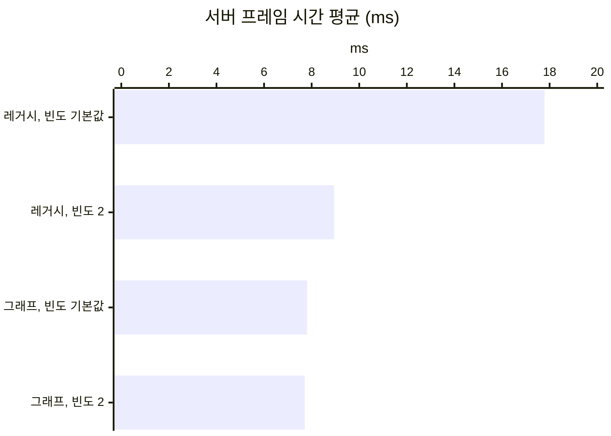

# 14. 레거시 리플리케이션을 Replication Graph로 바꾸기

## 요약

[자원 노드의 Net Update Frequency 낮추기](../08-node-update-frequency/README.md)는 먼 자원 노드를 Consider List에서 뺐다. 하지만 서버는 그 자원 노드를 여전히 프레임마다 돌았다. 그래서 서버의 리플리케이션을 엔진의 Replication Graph로 바꿨다.

같은 출발점에서 그래프는 빈도를 낮추는 방법보다 서버 프레임 시간을 더 줄였다. 그래프에서는 자원 노드의 빈도를 낮출 필요도 없었다. 대신 연결당 송신 대역폭이 8.8% 늘었다.

| 지표 | 지금 구성 | 그래프로 바꾼 뒤 | 변화 |
| --- | --- | --- | --- |
| 서버 프레임 시간 평균 | 8.94ms | 7.71ms | -13.8% |
| 리플리케이션 시간 | 3.96ms | 2.92ms | -26.1% |
| 연결당 송신 대역폭 | 10,100바이트/초 | 11,000바이트/초 | +8.8% |
| 1번 클라이언트에 존재하는 자원 노드 | 176개 | 380개 | +204개 |


서버가 1번 클라이언트에게 보낼지 프레임마다 확인하는 자원 노드를 그렸다. 왼쪽 레거시는 150m 밖의 주황 점까지 프레임마다 확인한다. 오른쪽 그래프는 1번 클라이언트가 서 있는 파란 칸의 목록만 확인한다. 칸 경계와 거리는 실제 값이고, 점의 위치는 같은 밀도의 예시다.

수치는 구성마다 세 번 실행한 중앙값이다. 실행별 값, 계산식, 엔진 소스 위치는 [측정 기록](measurements.md)에 있다. "연결"은 서버와 클라이언트 하나 사이의 통신을 뜻한다.

## 문제: 먼 자원 노드가 활성 목록에 남는다

서버는 리플리케이트하는 액터를 활성 목록에 둔다. 활성 목록은 서버가 아직 보낼지 따져야 하는 액터의 목록이다. 서버는 프레임마다 활성 목록을 돌아 Consider List를 만든다. Consider List는 이번 프레임에 리플리케이션 대상으로 고려할 액터의 목록이다.

자원 노드는 모든 연결에서 Dormant 상태가 되어야 활성 목록에서 빠진다. 플레이어 무리에서 150m 밖의 자원 노드는 어느 연결로도 보낸 적이 없다. 그래서 Dormant 상태가 되지 못하고 활성 목록에 남는다.

[직전의 방법](../08-node-update-frequency/README.md)은 이 자원 노드를 16프레임에 한 번만 고려하게 했다. 그래도 고려할 차례인지 보려고 서버는 프레임마다 활성 목록을 돈다.

| 빈도를 낮춘 뒤의 리플리케이션 시간(프레임당) | 시간 |
| --- | ---: |
| ① 활성 목록을 돌아 Consider List 만들기 | 0.959ms |
| ② 연결마다 Consider List를 거리 검사하고 정렬하기 | 0.845ms |
| ③ 정렬한 액터를 비교, 직렬화, 송신하기 | 1.87ms |

①과 ②는 보낼지 따지는 일이다. 이 둘을 합친 시간이 실제로 보내는 ③과 비슷하다. ①의 약 3분의 2는 건너뛰는 자원 노드를 도는 몫이다.

## 원리: 시점이 있는 칸의 목록만 모은다

**Replication Graph**는 엔진 플러그인이다. 레거시가 프레임마다 만드는 목록을 프레임을 넘어 유지되는 목록으로 바꾼다. 서버는 액터를 미리 목록에 나눠 넣는다. 연결마다 필요한 목록만 모아서 보낸다. 보내는 일은 레거시와 같은 함수가 한다.

그래프는 맵을 같은 크기의 칸으로 나눈다. 칸의 크기는 엔진의 예제 그래프와 같은 100m로 두었다. 액터는 자기 위치에서 150m가 걸치는 모든 칸에 미리 들어간다. 연결은 시점이 있는 칸 하나의 목록만 모은다. 모은 목록은 레거시처럼 150m 거리 검사를 거친다.

Dormant 상태의 액터는 칸마다 연결별 목록에 따로 있다. 그 연결에서 Dormant 상태가 되면 서버는 그 목록에서 액터를 지운다. 그래서 자리를 잡은 뒤에는 이미 받은 자원 노드를 다시 따지지 않는다. 다른 칸의 자원 노드는 이 연결이 아예 보지 않는다.

엔진의 예제 그래프에서 두 가지를 바꿨다. 예제는 움직이는 액터를 세 묶음으로 나눠 3프레임에 한 번만 모은다. 보내는 횟수가 바뀌면 효과가 섞이므로 묶음을 하나로 두었다. 보내는 간격도 레거시가 액터를 고려하는 평균 간격에 맞췄다.

그래프의 간격은 프레임 수다. 레거시는 다음 고려 시각에 0\~1프레임의 난수를 더한다. 그래서 NPC는 4프레임, 자원 노드는 16프레임으로 맞출 수 있다. 플레이어 캐릭터는 레거시가 평균 1.3프레임마다 고려한다. 정수로 맞출 수 없어 그래프는 매 프레임 보낸다.

**예상.** 레거시는 프레임마다 활성 목록 5,272개를 돈다. 그래프에서 한 연결이 모으는 액터는 약 75개로 계산된다. ①과 ②의 1.80ms는 대부분 줄 것이다. 반면 캐릭터를 보내는 횟수는 약 1.3배가 되어 대역폭이 늘 것이다.

## 적용: 실행 인자로 그래프를 만든다

```diff
 // Source/DSOptLab/DSOptLab.cpp
+	// -LabReplicationGraph일 때만 서버의 GameNetDriver에 그래프를 만든다.
+	UReplicationDriver::CreateReplicationDriverDelegate().BindLambda(
+		[](UNetDriver* ForNetDriver, const FURL& URL, UWorld* World) -> UReplicationDriver*
+		{
+			if (World && ForNetDriver && ForNetDriver->NetDriverName == NAME_GameNetDriver)
+			{
+				return NewObject<ULabReplicationGraph>(GetTransientPackage());
+			}
+			return nullptr;
+		});

 // Source/DSOptLab/LabReplicationGraph.cpp
+	// 움직이는 액터를 매 프레임 모으고, 간격은 클래스마다 정한 프레임 수가 정한다.
+	UReplicationGraphNode_ActorListFrequencyBuckets::DefaultSettings.NumBuckets = 1;
+	GridNode = CreateNewNode<UReplicationGraphNode_GridSpatialization2D>();
+	GridNode->CellSize = 10000.f; // 100m
+
+	// 레거시의 평균 고려 간격: (틱 ÷ 빈도) + 1프레임
+	const int32 Frames = FMath::RoundToInt(TickRate / NetUpdateFrequency + 1.f);
```

액터를 나누는 규칙은 엔진의 예제 그래프와 같다. 모든 연결에 보내는 액터, 소유자에게만 보내는 액터, 나머지 격자다. 구성은 실행 인자로 바꾼다.

| 구성 | 더한 실행 인자 |
| --- | --- |
| 레거시, 빈도 기본값 | 없음 |
| 레거시, 빈도 2(지금 구성) | `-NodeUpdateFrequency 2` |
| 그래프, 빈도 기본값 | `-ReplicationGraph` |
| 그래프, 빈도 2 | `-ReplicationGraph -NodeUpdateFrequency 2` |
| 그래프, trickle 끔 | `-ReplicationGraph -RepGraphNoTrickle -NodeUpdateFrequency 2` |

모든 구성은 [NPC 이동을 필요한 비트만 담은 구조체로 보내기](../12-npc-move-netserialize/README.md)의 나머지 인자를 그대로 쓴다. 위의 네 구성을 세 번씩 연달아 쟀다. trickle을 끈 구성은 지금 구성, 그래프와 함께 따로 연달아 쟀다. 이 시점의 코드는 태그 [`post-14-replication-graph`](https://github.com/hon454/ue-dedicated-server-optimization-lab/tree/post-14-replication-graph)에 있다.

## 결과

### 같은 출발점에서 그래프가 더 줄였다

| 구성 | 서버 프레임 시간 평균 | 리플리케이션 시간 |
| --- | ---: | ---: |
| 레거시, 빈도 기본값 | 17.8ms | 12.7ms |
| 레거시, 빈도 2(지금 구성) | 8.94ms | 3.96ms |
| 그래프, 빈도 기본값 | 7.81ms | 2.95ms |
| 그래프, 빈도 2 | 7.71ms | 2.92ms |



출발점은 레거시에 자원 노드의 빈도를 기본값으로 둔 구성이다. 자원 노드의 빈도를 2로 낮추면 서버 프레임 시간이 8.94ms가 됐다. 그래프로 바꾸면 7.81ms가 됐다. 같은 출발점에서 그래프가 1.14ms 더 짧다. 그래프에서 빈도를 2로 낮춘 차이는 구별되지 않았다. Dormant 상태가 된 자원 노드를 그래프가 다시 모으지 않기 때문으로 본다.

### 보낼지 따지는 일은 줄고 보내는 일은 늘었다

지금 구성과 그래프(빈도 2)를 비교했다. 보낼지 따지는 일은 2.45ms에서 1.14ms로 줄었다. 남은 몫은 그래프의 일이다. 그래프는 칸을 모으고, 거리 검사하고, 움직이는 액터의 칸을 옮긴다.

실제로 보내는 일은 1.51ms에서 1.79ms로 늘었다. 캐릭터를 더 자주 보낸 몫이 들어 있다. 그래프가 보내는 액터마다 더 하는 일도 섞여 있다.

### 늘어난 대역폭은 캐릭터 몫이다

한 연결이 보낸 캐릭터 데이터는 초당 3,080바이트에서 3,880바이트가 됐다. 늘어난 액터 데이터의 77%다. 나머지는 늘어난 캐릭터 Bunch의 헤더다. Bunch는 액터 하나의 데이터를 패킷에 담는 단위다. 자원 노드가 보낸 데이터는 초당 2바이트로 같았다.

> **trickle: 그래프는 150m 밖의 Dormant 자원 노드도 보낸다**
>
> 그래프에서 클라이언트가 가진 자원 노드는 176개에서 380개가 됐다. 150m 밖의 자원 노드는 거리 검사에서 걸러져 Dormant 상태가 되지 못한다. 그러면 칸의 연결별 목록에 남아 매 프레임 다시 돈다.
>
> 엔진은 이 목록을 비우려고 남은 액터를 한 프레임에 하나씩 거리와 상관없이 보낸다. 받은 액터는 Dormant 상태가 되어 목록에서 빠진다. 엔진은 이 동작을 trickle이라고 부른다. 콘솔 변수 `Net.RepGraph.TrickleDistCullOnDormancyNodes`로 끈다.
>
> | 레거시 | 그래프 | 그래프, trickle 끔 |
> | --- | --- | --- |
> |  |  |  |
> | 자원 노드 176개 | 380개 | 176개 |
>
> trickle을 끄자 클라이언트의 자원 노드는 레거시와 같은 176개가 됐다. 대신 서버 프레임 시간이 7.64ms에서 8.04ms로 늘었다. 함께 잰 지금 구성의 8.83ms보다는 짧다. 연결당 송신 대역폭은 같았다. trickle은 클라이언트 메모리를 써서 서버 CPU를 아끼는 장치로 읽힌다.
>
> 그래프는 보낼지 확인하는 방법만 바꾼다. 그래서 보내는 액터와 횟수가 같으면 송신량도 같다([Replication Graph 정리 글](https://hon454.github.io/posts/unreal-engine-replication-graph/)). trickle은 보내는 자원 노드를 바꿨지만 측정 구간의 송신량은 바꾸지 않았다. 이 테스트베드에서 송신량을 바꾼 것은 캐릭터를 보내는 횟수였다.

### 화면 속 NPC는 그대로다

NPC의 표시 위치 오차와 표시 지연은 네 구성에서 구별되지 않았다. 그래프도 NPC를 레거시와 같은 간격으로 보냈다.

## 배운 것과 한계

- **활성 목록에서 빼려면 목록의 구조를 바꿔야 한다.** 빈도를 낮추면 Consider List에서는 빠지지만 활성 목록은 그대로 돈다. 그래프는 연결마다 칸의 목록만 모아서 이 순회를 없앴다.
- **그래프는 따지는 일을 줄이고 보내는 일에 비용을 더한다.** 이 테스트베드에서는 따지는 일이 보내는 일만큼 컸다. 그래서 서버 프레임 시간이 13.8% 줄었다. 보내는 일이 대부분인 구성이라면 이득이 작거나 없을 것으로 추정한다.
- **간격이 프레임 단위다.** 레거시의 평균 1.3프레임을 그래프는 정수로 맞출 수 없다. 캐릭터처럼 자주 보내는 액터는 간격을 따로 정해야 한다. 플레이어가 한곳에 모인 배치만 쟀다.

측정 환경의 한계는 [테스트베드와 측정 방법](../00-testbed/README.md)의 "한계"에 있다.

**다음 글.** 엔진에는 리플리케이션 시스템이 하나 더 있다. Iris는 Replication Graph와 함께 쓸 수 없다. 다음 글은 같은 시나리오를 Iris로 바꿔 지금까지의 레거시 구성과 비교한다.
