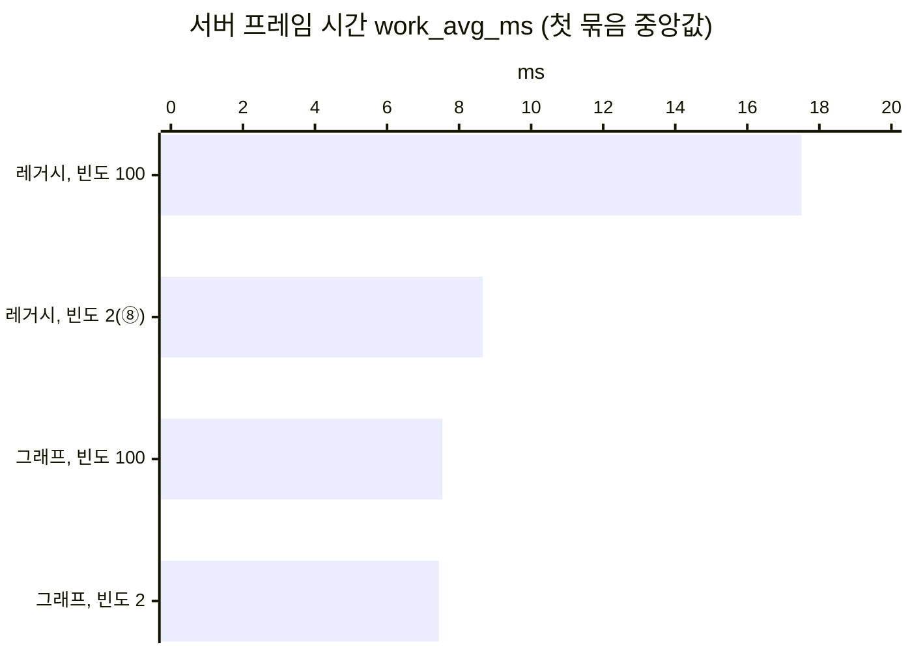

# 포스팅 14 후보 기법 자료 (Replication Graph)

2막 구현 계획 단계 5의 2번(관찰 자료)이다. 기준 구성은 포스팅 12의 최종 구성(⑧, `-NodeUpdateFrequency 2 -InventoryOwnerOnly -InventoryFastArray -NpcInterpDelay 150 -NpcCompactMove`)이다. 새로 재지 않고 지난 실행에서 읽었다: `act2-net-base1-r3`(⑧에 `-MotionLog`, 2026-10-07, `work_avg_ms` 세 실행의 중앙값 실행), `act2-nodeuf-split1-r3`(④에 `-StatNamedEvents`, 2026-10-06). 기준 묶음은 기법을 구현한 뒤 적용 묶음과 연달아 다시 잰다. 엔진 소스는 언리얼 엔진 5.8.3(`G:\Epic Games\UE_Source`, 태그 `5.8.3-release`)이고, 아래에서 `RG.cpp`는 `Engine/Plugins/Runtime/ReplicationGraph/Source/Private/ReplicationGraph.cpp`, `RG.h`는 같은 플러그인의 `Source/Public/ReplicationGraph.h`, `ND.cpp`는 `Engine/Source/Runtime/Engine/Private/NetDriver.cpp`다. 예상은 모두 계산값이고 확인하지 않았다.

## 1. 남은 비용: 활성 목록을 따지는 두 단계

| 값 | 프레임당 | 출처 |
| --- | ---: | --- |
| `GameNetDriver` Incl / Excl | 4.002 / 2.458ms | `act2-net-base1-r3`(`export-insights.ps1`) |
| 그 아래 클래스 타이머의 합 | 1.544ms(`LabNpc` 0.871, `LabCharacter` 0.492 등) | 같은 실행 |
| `Consider Actors Time`(①) | 0.959ms | `act2-nodeuf-split1-r3`, [포스팅 8 측정 기록](../08-node-update-frequency/measurements.md) 2절 |
| `Prioritize Actors Time`(②) | 0.845ms | 같음 |
| `Process Prioritized Actors Time`(③) | 1.868ms | 같음 |
| ① 가운데 건너뛰는 자원 노드의 몫 | 약 0.622ms(약 4,857개 × 0.128µs) | 같음, 연립식으로 푼 근사 |

- ①과 ②의 합 1.80ms는 `GameNetDriver` Incl 4.081ms의 44%다(`act2-nodeuf-split1-r3`). ⑤\~⑧은 인벤토리와 NPC가 보내는 비트를 줄였을 뿐 활성 목록의 길이를 바꾸지 않으므로, ⑧에서도 ①과 ②는 비슷하다고 본다(확인하지 않음. ⑧의 `-StatNamedEvents` 실행은 없다).
- 활성 목록은 5,272개이고 그 가운데 자원 노드가 4,887개다([포스팅 7 측정 기록](../07-net-driver-breakdown/measurements.md)). 플레이어 무리에서 150m 밖의 자원 노드는 어느 연결에서도 채널이 열리지 않아 Dormant 상태가 되지 못하고 활성 목록에 남는다(engine-notes.md "휴면 액터와 관련성"). 포스팅 8은 이 자원 노드가 Consider List에 드는 간격만 늘렸다. 활성 목록에서 빼지는 못해서 건너뛰는 비용 약 0.62ms가 남았다.

## 2. Replication Graph가 하는 일 (엔진 소스)

| 사실 | 소스 위치 |
| --- | --- |
| 플러그인은 `Engine/Plugins/Runtime/ReplicationGraph/`이고 기본으로 꺼져 있으며 베타다(`EnabledByDefault` false, `IsBetaVersion` true). 플러그인과 `UReplicationGraph`에 폐기 표시는 없다 | `ReplicationGraph.uplugin:13, 15` |
| 넷 드라이버는 서버에서 Iris를 쓰지 않을 때만 `ReplicationDriverClassName`의 클래스를 만든다. `CreateReplicationDriverDelegate`가 묶여 있으면 그것이 먼저다 | `ND.cpp:1820-1831, 1865-1870, 8077-8112`, `Engine/Source/Runtime/Engine/Classes/Engine/ReplicationDriver.h:11-21` |
| 드라이버가 있으면 `ServerReplicateActors`가 곧바로 드라이버에 넘긴다. 레거시의 연결 준비, 활성 목록 순회, `ServerReplicateActors_BuildConsiderList`는 돌지 않는다 | `ND.cpp:6295-6298`(그 뒤 `6303-6373`) |
| 액터는 드라이버가 있어도 활성 목록(`NetworkObjectList`)에 들어가고 Dormant 상태 기록도 계속된다. 프레임마다 돌지만 않는다 | `ND.cpp:978-988, 7096-7102` |
| `GameNetDriver` 타이머(`TickFlush`)는 그래프의 일도 감싼다. 기본 트레이스에서 그 아래에 `UReplicationGraph_ServerReplicateActors`가 생긴다 | `ND.cpp:1174, 1224-1230`, `RG.cpp:1144` |
| 연결마다 전역 노드와 연결 노드에서 액터 목록을 모으고(gather), 모은 목록만 우선순위를 매겨 보낸다. 우선순위는 `GetNetPriority`가 아니라 거리, 마지막으로 보낸 뒤 지난 프레임, 시점 액터 여부로 정한다. `IsNetRelevantFor`도 쓰지 않는다 | `RG.cpp:1192-1428, 1449-1704`, `RG.h:20` |
| 액터를 보내는 간격은 `NextUpdateTime`(초)이 아니라 프레임 수 `ReplicationPeriodFrame`이다. `UBasicReplicationGraph`는 클래스 기본 객체의 `NetUpdateFrequency`를 `NetServerMaxTickRate ÷ 빈도`로 바꾼다(빈도 2는 15프레임, 10은 3프레임) | `RG.cpp:2097-2098`, `RG.h:1083-1093`, `BasicReplicationGraph.cpp:43` |
| 실제 직렬화는 레거시와 같은 `UActorChannel::ReplicateActor`다. 그래서 `COND_OwnerOnly`, FastArray, 클래스 타이머(`LabNpc` 등)가 그대로다 | `RG.cpp:2151, 2157`, `Engine/Source/Runtime/Engine/Private/DataChannel.cpp:3602, 3812` |
| 송신 한도 포화 기록(`TrackReplicationForAnalytics`)은 그래프도 남긴다. `saturated_ratio`를 그대로 쓸 수 있다 | `RG.cpp:1256` |

### 2.1 공간 격자(`UReplicationGraphNode_GridSpatialization2D`)

- 액터는 자기 위치 ± 컬 거리의 사각형이 걸치는 모든 칸에 들어간다. 연결은 시점이 있는 칸 하나에서만 모은다(`RG.cpp:5688-5743, 6238-6293`).
- `AddActor_Dormancy`는 Dormant 상태를 원하는 액터를 정적 액터로, 아닌 액터를 동적 액터로 넣는다. 깨면 동적, 다시 Dormant 상태가 되면 정적으로 옮긴다(`RG.cpp:5352-5367, 5634-5652`).
- 정적 액터는 넣을 때 한 번만 칸을 정한다. 동적 액터는 프레임마다 위치를 다시 읽어 칸을 옮긴다(`RG.cpp:5472-5495, 5852-6142`).
- 칸 안의 Dormant 정적 액터는 칸의 Dormancy 노드에 있다. 연결이 그 칸을 처음 모을 때 연결별 목록으로 복사하고, 그 연결에서 Dormant 상태가 된 액터는 목록에서 지운다. 자리를 잡은 뒤에는 이미 Dormant 상태인 액터를 다시 돌지 않는다(`RG.cpp:5016-5067, 4694-4716`, `RG.h:433-439`).
- 칸의 동적 액터 목록은 기본이 `UReplicationGraphNode_ActorListFrequencyBuckets`이고 버킷 3개 중 하나만 한 프레임에 돌려준다(`RG.h:247-250`, `RG.cpp:3915-3920, 5269-5284`). 소스대로라면 다른 플레이어의 캐릭터와 NPC는 3프레임에 한 번만 모인다. 실행으로 확인하지 않았다.

### 2.2 기본 제공 그래프(`UBasicReplicationGraph`)

- `bAlwaysRelevant`는 모든 연결의 목록, `bOnlyRelevantToOwner`는 소유자 연결의 목록, 나머지는 모두 격자의 `AddActor_Dormancy`로 보낸다(`BasicReplicationGraph.cpp:91-116`). 칸 크기는 100m다(`68-72`).
- 컬 거리와 갱신 간격은 클래스 기본 객체에서 읽고, 실행 중 액터마다 바꾸는 것은 따라가지 않는다(`BasicReplicationGraph.h:29-37`).
- 이 프로젝트의 클래스는 생성자에서 명령줄로 만든 설정(`FLabServerConfig::Get()`, 처음 부를 때 `FCommandLine`을 읽는 static)을 읽어 `NetUpdateFrequency`, `NetDormancy`, `bAlwaysRelevant`를 정한다(`LabResourceNode.cpp:12-29`, `LabNpc.cpp:215-233`, `LabBuilding.cpp:10-22`). 클래스 기본 객체도 같은 생성자를 거치므로 같은 값을 가질 것으로 본다(확인하지 않음).
- 이 테스트베드의 리플리케이트 클래스가 가는 곳(소스대로):

| 클래스 | 레거시 설정 | `UBasicReplicationGraph`에서 |
| --- | --- | --- |
| `ALabResourceNode` | `DORM_DormantAll`, 빈도 2(④부터), 150m | 격자 정적 액터(Dormancy 노드), 15프레임 간격 |
| `ALabBuilding` | `DORM_DormantAll`, 150m | 격자 정적 액터(Dormancy 노드) |
| `ALabNpc` | 빈도 10, 150m | 격자 동적 액터(버킷), 3프레임 간격 |
| `ALabCharacter` | 기본값(빈도 100), 150m | 자기 캐릭터는 연결 노드, 다른 플레이어의 캐릭터는 격자 동적 액터(버킷) |
| `ALabPlayerController`, `AGameplayDebuggerCategoryReplicator` | `bOnlyRelevantToOwner`(`Controller.cpp:67`, `GameplayDebuggerCategoryReplicator.cpp:573`) | 소유자 연결의 목록 |
| `AGameStateBase`, `APlayerState` | `bAlwaysRelevant`(`GameStateBase.cpp:26`, `PlayerState.cpp:26`) | 모든 연결의 목록 |

`AGameplayDebuggerCategoryReplicator`는 `IsNetRelevantFor`를 고쳐 쓰는데(`GameplayDebuggerCategoryReplicator.cpp:721`) 그래프는 이것을 부르지 않는다. 이 프로젝트의 클래스는 `IsNetRelevantFor`와 `GetNetPriority`를 고쳐 쓰지 않는다(grep).

## 3. 후보

모두 실행 인자 `-ReplicationGraph`(서버 `-LabReplicationGraph`)로 켜고 기본값은 끈다. 넷 드라이버가 드라이버를 만들 때 쓰는 `CreateReplicationDriverDelegate`를 게임 모듈에서 묶고, 인자가 있을 때만 그래프를 만든다(Lyra가 같은 방식이다, `Samples/Games/Lyra/Source/LyraGame/System/LyraReplicationGraph.cpp:138-184`). ini의 `ReplicationDriverClassName`은 실행마다 바꿀 수 없어서 쓰지 않는다. 공통으로 `.uproject`에 플러그인, `DSOptLab.Build.cs`에 `ReplicationGraph` 모듈을 더한다(`Samples/Games/Lyra/Lyra.uproject:86-89`, `LyraGame.Build.cs:22`).

### A. `UBasicReplicationGraph` 그대로

- **구현**: 위 공통 부분과 델리게이트 수십 줄.
- **대가**: 2.1의 버킷 때문에 다른 플레이어의 캐릭터가 매 프레임에서 3프레임에 한 번으로 바뀐다(소스대로라면). 격자로 바꾼 효과와 캐릭터 갱신 빈도를 낮춘 효과가 한 묶음에 섞인다.

### B. `UBasicReplicationGraph`를 상속해 버킷만 하나로

- **구현**: A에 하위 클래스 하나. 동적 액터 버킷을 1개로 두어(`UReplicationGraphNode_ActorListFrequencyBuckets::DefaultSettings`, Lyra가 바꾸는 곳 `LyraReplicationGraph.cpp:468-472`) 동적 액터가 자기 `ReplicationPeriodFrame`대로 모이게 한다. 클래스별 CSV(`FReplicationGraphCSVTracker`, `ReplicationGraphTypes.h:1903-1959`)를 켠다. 약 100줄.
- **대가**: 레거시와 다른 점이 격자로 모으는 것과 우선순위 매기는 법으로 줄어든다. 우선순위 방식이 다른 것은 남는다(포화가 없어 송신 순서만 바뀐다고 본다).

### C. Lyra처럼 클래스마다 경로를 정하는 그래프

- **구현**: 클래스별 경로 표, 클래스별 간격과 컬 거리, PlayerState 제한 노드. 수백 줄.
- **대가**: 이 테스트베드에는 B로 충분한 클래스만 있다. 더 얻는 것이 없다.

### 비교할 묶음

| 묶음 | 리플리케이션 | 자원 노드 빈도 | 무엇을 보나 |
| --- | --- | --- | --- |
| X0(기준) | 레거시 | 2 | ⑧ 그대로 |
| X1 | Replication Graph | 2 | ⑧에서 Replication Graph만 바꿈. README의 ⑨ 단계 |
| Y1 | Replication Graph | 기본값(100) | 포스팅 8의 방법 없이 그래프만으로 같은 문제를 푸는지 |

포스팅 13의 "다음 글"이 "두 방법의 비용을 비교한다"고 적었으므로 X0과 Y1의 비교가 그 약속이다. 레거시에 빈도 기본값인 묶음(③)을 더해 2 × 2로 잴 수도 있다.

## 4. 예상 (계산)

- 자원 노드는 맵 1,900m × 1,900m에 고르게 놓인다(`LabGameMode.cpp:96-99`, `WorldHalfExtent` 95,000cm). 밀도는 5,001 ÷ 3,610,000m² = 0.00139개/m²다.
- 100m 칸 하나에는 칸에서 150m 안의 자원 노드가 들어간다. 400m × 400m = 160,000m²에 약 222개다. 이 자원 노드는 Dormant 상태가 된 뒤 연결별 목록에서 빠지므로, 자리를 잡은 뒤 연결마다 도는 자원 노드는 거의 없다. 나머지 약 4,780개는 시점이 없는 칸에 있어 어느 연결도 돌지 않는다.
- 연결마다 모이는 액터는 NPC(플레이어 주변 50개와 맵의 300개 가운데 칸 범위의 약 13개), 캐릭터 8개, 소유자 액터와 모든 연결의 액터 몇 개로 약 75개다. 레거시 ②는 연결마다 Consider List 약 415개를 따졌다(`act2-nodeuf-split1-r3`, 활성 목록 5,272 − 건너뛴 4,857).
- 그래서 ①과 ②의 1.80ms 가운데 대부분이 그래프의 gather와 연결별 우선순위로 바뀌고, 그 비용은 액터 수로 보아 그보다 작다고 본다. ③(직렬화와 송신)은 같은 `ReplicateActor`라 그대로다. 동적 액터 358개의 위치를 프레임마다 다시 읽는 비용(`PrepareForReplication`)이 새로 든다. 이 두 비용은 재 봐야 안다.
- Y1에서는 자원 노드 빈도가 기본값이어도 Dormant 상태가 된 자원 노드는 모이지 않으므로 X1과 거의 같다고 본다. 같다면 Replication Graph만으로 포스팅 8의 방법이 필요 없어진다.

## 5. 측정에서 달라지는 것

- `work_avg_ms`, `netflush_avg_ms`, `out_bytes_per_sec_per_conn`, `open_actor_channels_per_conn`, `saturated_ratio`와 리플리케이션 시간 타이머 `GameNetDriver`는 그대로 쓴다(2절).
- Consider List 길이(`LabMetricsSubsystem.cpp`의 `SampleConsideredActors`, 엔진 지표 `NumConsideredActors`)는 레거시 경로에서만 남는다. 그래프 묶음에서는 0이거나 없다. 연결마다 모은 액터 수를 내는 엔진 CSV는 없고, `Net.RepGraph.PrintCulledOnConnectionClasses 1`이 로그로만 남긴다(`RG.cpp:109-111, 1693-1702`).
- `-StatNamedEvents` 실행에서 ①, ②의 타이머는 사라지고 `NET_ReplicateActors_GatherForConnection`, `NET_ReplicateActors_PrioritizeForConnection`, `NET_ReplicateActors_ReplicateActorsForConnection`이 생긴다(`RG.cpp:1288, 1484, 1685`). 레거시와 그래프의 타이머 이름이 달라서 단계별 비교는 이름을 짝지어 한다.

## 6. 에이전트 의견

**B를 추천하고, 묶음은 X0, X1, Y1 셋을 추천한다.** B는 A보다 약 100줄 많지만 캐릭터 갱신 빈도가 3분의 1로 바뀌는 효과를 빼서 "포스팅 하나에 기법 하나"를 지킨다. X1은 README에 ⑨로 더할 값이고, Y1은 포스팅 13이 약속한 "두 방법의 비교"다. 세 묶음은 연달아 약 25분이다(포스팅 13의 15회가 41분). 2 × 2로 레거시 빈도 기본값까지 재면 비교가 완전해지지만, 그 묶음은 포스팅 8에서 이미 쟀고 본문에 구성 넷을 설명하면 분량이 늘어난다.

2026-10-19에 묶음의 추천을 2 × 2로 바꿨다. 포스팅 8의 묶음은 다른 날의 묶음이라 이번 묶음과 비교할 수 없다(STATUS.md "명령"). 두 방법이 같은 출발점에서 얼마나 줄였는지는 X−를 같은 묶음 안에서 재야 나온다. 측정은 약 33분이다.

## 7. 선택

사용자가 B와 2 × 2를 골랐다(2026-10-19). 묶음은 아래 넷이고 모두 ⑧의 인자에 `-MotionLog`를 더한다.

| 묶음 | 리플리케이션 | 자원 노드 빈도 |
| --- | --- | --- |
| X− | 레거시 | 기본값(100) |
| X0 | 레거시 | 2 |
| Y1 | Replication Graph | 기본값(100) |
| X1 | Replication Graph | 2 |

구현에서 정한 것(에이전트):

- `UBasicReplicationGraph`는 플러그인 밖으로 내보내지 않은 클래스라(`BasicReplicationGraph.h`의 `UCLASS(transient, config=Engine)`, 모듈 API 표시 없음) 상속하지 못한다. 그래서 `UReplicationGraph`를 상속한 `ULabReplicationGraph`(`Source/DSOptLab/LabReplicationGraph.cpp`)에 같은 경로를 옮겼다. 칸 100m, 기준점, 액터를 나누는 규칙이 같다.
- 동적 액터 버킷을 1개로 두었다(`UReplicationGraphNode_ActorListFrequencyBuckets::DefaultSettings.NumBuckets`).
- 클래스마다 보내는 간격을 레거시가 실제로 고려하는 간격의 평균에 맞췄다. 레거시는 다음 고려 시각을 1/빈도 + 0\~1프레임의 난수 뒤로 잡고(`NetDriver.cpp:5421-5425`), 그 시각이 지난 첫 프레임에 다시 고려한다(`5318-5319`). 그래서 평균 간격은 (30 ÷ 빈도) + 1프레임이다. 엔진의 변환(`RG.h:1083-1093`, 30 ÷ 빈도를 반올림)을 쓰면 NPC가 4프레임에서 3프레임 간격이 되어 NPC 갱신이 3분의 1 늘어난다. 결과: 자원 노드 16프레임(빈도 2), NPC 4프레임, 캐릭터와 건축물 1프레임(서버 로그 `lab_repgraph_class`). 캐릭터는 레거시의 평균 1.3프레임보다 짧다(정수 간격이라 맞출 수 없다).
- 그래프가 연결마다 만드는 디버그 액터(`AReplicationGraphDebugActor`, Shipping이 아닌 빌드, `RG.h:64-66`)를 만들지 않는다. 레거시에는 없는 액터다.
- 클래스별 CSV(`FReplicationGraphCSVTracker`)는 켜지 않았다. CSV 프로파일러를 쓰지 않고, 클래스별 시간은 Insights의 클래스 타이머로 본다.
- 실행 인자는 `-ReplicationGraph`(서버 `-LabReplicationGraph`)다. 게임 모듈이 뜰 때 `CreateReplicationDriverDelegate`를 묶고, 인자가 없으면 묶지 않는다(`Source/DSOptLab/DSOptLab.cpp`).

사용자가 첫 묶음(9절)과 [Replication Graph 블로그 글](https://hon454.github.io/posts/unreal-engine-replication-graph/)을 보고 아래를 정했다(2026-10-19).

- trickle을 끈 그래프 묶음을 더해 세 묶음(⑧, 그래프, 그래프 trickle 끔)을 연달아 잰다. 실행 인자는 `-RepGraphNoTrickle`(서버 `-LabRepGraphNoTrickle`, `-ReplicationGraph`와 함께만)이고, 그래프가 초기화 때 `Net.RepGraph.TrickleDistCullOnDormancyNodes`를 0으로 둔다(에이전트가 정함).
- 본문에서 trickle은 인용구로 따로 설명한다. 블로그 글의 "어느 연결에 무엇을 보낼지가 같다면 송신량도 같다"와 이 테스트베드의 결과가 어떻게 이어지는지를 함께 적는다.

작은 규모 확인(클라이언트 2, 자원 노드 100, NPC 10과 플레이어 주변 50, ⑧의 인자, `-NoTrace`. 수치는 비교에 쓰지 않는다):

| 값 | `tsmall-rg-base2-r1`(레거시) | `tsmall-rg2-r1`(그래프) |
| --- | --- | --- |
| 서버 로그의 리플리케이션 모델 | `Generic` | `LabReplicationGraph` |
| `open_actor_channels_per_conn` | 58 | 58 |
| `out_bytes_per_sec_per_conn` | 6,530 | 6,740 |
| NPC 수신 간격 평균 / P99(ms) | 133.5 / 166.6 | 133.7 / 166.7 |
| 표시 위치 오차 평균(cm) / 표시 지연(ms) | 46.61 / 155 | 47.17 / 158 |

- 디버그 액터를 끄기 전의 `tsmall-rg1-r1`은 채널이 60이었다(레거시 `tsmall-rg-base1-r1` 58).
- 그래프에서도 활성 목록(`NetworkObjectList`)은 채워지고, 서버 로그 `lab_network_objects`에 레거시에는 없던 리플리케이트하지 않는 액터(`PlayerCameraManager`, `GameSession` 등)가 보인다. 그래프는 리플리케이트하지 않는 액터를 받지 않으므로(`ReplicationGraphTypes.h:339-350`) 보내는 데에는 영향이 없다.

## 8. 확인하지 않은 것

- ⑧에서의 ①, ②의 크기(④의 `-StatNamedEvents` 실행에서 읽었다).
- 작은 규모에서 그래프가 3.2% 더 보낸 이유. 캐릭터의 간격(레거시 평균 1.3프레임, 그래프 1프레임)으로 보지만 확인하지 않았다. 확정 규모에서 Networking Insights의 클래스별 비트로 확인한다.
- 그래프에서 클라이언트에 남는 Dormant 자원 노드: 그래프도 기본값에서는 지우지 않는다(`Net.RepGraph.DormantDynamicActorsDestruction` 기본값 0, `RG.cpp:125-127`). 이 문제는 포스팅 14의 범위 밖으로 둔다.
- 그래프의 gather, 연결별 우선순위, 동적 액터 위치 갱신의 비용.

## 9. 확정 규모 2 × 2 (첫 묶음)

2026-10-19 16:22\~16:54에 본체 화면에서 연달아 쟀다. 모두 ⑧의 인자에 `-MotionLog`를 더했다. 12회 모두 종료 코드 0이고, 서버 로그의 리플리케이션 모델(`Generic` 또는 `LabReplicationGraph`), `lab_repgraph_class`(그래프 묶음에만, 자원 노드 간격 1 또는 16프레임), `lab_buildings clusters=1 per_cluster=500`, `lab_npcs_near_players clusters=1`을 확인했다. `lab_npc_move_clamped`는 없었다.

### 9.1 CSV

| 라벨 | frames | work_avg_ms | work_p99_ms | over_budget_frames | netflush_avg_ms | out_bytes_per_sec_per_conn | open_actor_channels_per_conn | saturated_ratio |
| --- | --- | --- | --- | --- | --- | --- | --- | --- |
| `act2-rg-base-nodedef1-r1` | 1798 | 17.506 | 25.237 | 1 | 12.963 | 10097 | 77 | 0.000 |
| `act2-rg-base-nodedef1-r2` | 1786 | 19.033 | 25.698 | 1 | 14.210 | 10054 | 77 | 0.000 |
| `act2-rg-base-nodedef1-r3` | 1797 | 16.285 | 23.747 | 1 | 11.808 | 10097 | 77 | 0.000 |
| `act2-rg-base1-r1` | 1788 | 8.583 | 12.791 | 0 | 4.184 | 10069 | 77 | 0.000 |
| `act2-rg-base1-r2` | 1787 | 8.665 | 12.853 | 0 | 4.220 | 10073 | 77 | 0.000 |
| `act2-rg-base1-r3` | 1787 | 8.662 | 12.811 | 1 | 4.209 | 10083 | 77 | 0.000 |
| `act2-rg-nodedef1-r1` | 1787 | 7.424 | 10.945 | 0 | 3.113 | 10954 | 77 | 0.000 |
| `act2-rg-nodedef1-r2` | 1788 | 7.756 | 11.184 | 1 | 3.201 | 10953 | 77 | 0.000 |
| `act2-rg-nodedef1-r3` | 1788 | 7.537 | 10.757 | 1 | 3.195 | 10969 | 77 | 0.000 |
| `act2-rg1-r1` | 1788 | 7.437 | 10.370 | 1 | 3.168 | 10957 | 77 | 0.000 |
| `act2-rg1-r2` | 1796 | 7.387 | 10.336 | 1 | 3.108 | 11004 | 77 | 0.000 |
| `act2-rg1-r3` | 1789 | 7.458 | 10.672 | 0 | 3.181 | 10962 | 77 | 0.000 |

`work_avg_ms` 중앙값(변동 폭): X− 17.506(2.748), X0 8.662(0.082), Y1 7.537(0.332), X1 7.437(0.071). [measurement.md](../../Docs/Guides/measurement.md)의 기준(중앙값의 변화가 큰 쪽 변동 폭보다 큼)으로:

- X0 → X1(⑧에 그래프): -1.225(-14.1%), 구별된다. `out_bytes_per_sec_per_conn`은 10,073 → 10,962(+8.8%), 구별된다.
- X− → X0(빈도 2): -8.844(-50.5%). X− → Y1(그래프): -9.969(-56.9%). 둘 다 구별된다.
- X0와 Y1(두 방법): 8.662와 7.537, 차이 1.125가 변동 폭 0.332보다 크다.
- Y1와 X1: 차이 0.100이 변동 폭 0.332보다 작아 구별되지 않는다. 그래프에서는 자원 노드 빈도를 낮춰도 더 줄지 않는다.

### 9.2 Timing Insights (중앙값 실행, `export-insights.ps1`, 프레임당 ms)

| 값 | X− `r1` | X0 `r3` | Y1 `r3` | X1 `r1` |
| --- | ---: | ---: | ---: | ---: |
| 서버 프레임 시간 평균 | 17.788 | 8.944 | 7.809 | 7.710 |
| `GameNetDriver` Incl | 12.681 | 3.958 | 2.946 | 2.923 |
| `GameNetDriver` Excl | 10.854 | 2.448 | 0.362 | 0.362 |
| `UReplicationGraph_ServerReplicateActors` Incl / Excl | 없음 | 없음 | 2.584 / 0.778 | 2.561 / 0.774 |
| 클래스 타이머와 RPC 타이머의 합 | 1.827 | 1.511 | 1.806(계산) | 1.787(계산) |

- 레거시의 클래스 타이머는 `GameNetDriver` 바로 아래, 그래프의 클래스 타이머는 `UReplicationGraph_ServerReplicateActors` 아래에 있다. `export-insights.ps1`은 바로 아래만 내보내서 그래프 묶음의 클래스별 값은 아직 없다. 그래프 묶음의 합은 `UReplicationGraph_ServerReplicateActors`의 Incl - Excl로 셈했다.
- 따지는 일(레거시의 `GameNetDriver` Excl, 그래프의 `GameNetDriver` Excl + `UReplicationGraph_ServerReplicateActors` Excl): X0 2.448, X1 1.136(0.362 + 0.774). 그래프의 Excl에 gather, 우선순위, 동적 액터 위치 갱신이 섞여 있다.

### 9.3 품질 지표 (`analyze-motion.ps1`, 세 실행)

| 묶음 | 표시 위치 오차 평균(cm) | 표시 속도 오차 평균(cm/s) | 수신 간격 평균 / P99(ms) | 표시 지연(ms) |
| --- | --- | --- | --- | --- |
| X− | 48.73, 48.08, 48.26 | 15.8, 16.3, 15.4 | 133.4\~133.6 / 166.9\~167.0 | 163, 161, 161 |
| X0 | 45.91, 45.68, 45.63 | 15.0, 15.2, 15.3 | 133.5\~133.6 / 166.7\~166.8 | 154, 153, 153 |
| Y1 | 45.44, 45.42, 45.56 | 15.3, 15.5, 15.0 | 134.3\~134.4 / 166.5\~166.7 | 153, 152, 153 |
| X1 | 45.29, 45.99, 45.61 | 15.2, 15.4, 15.2 | 133.7\~134.3 / 163.2\~166.7 | 152, 154, 153 |

X−는 서버 프레임이 길어서(평균 17.8ms) 표시 지연이 약 8ms 길다. 나머지 셋은 구별되지 않는다.

### 9.4 그래프가 더 보내는 것: Dormancy 노드의 trickle

- 클라이언트 1번(내려다보기)의 화면 글자에서 t=75s의 자원 노드 수가 X0 176개, X1 380개였다(`act2-rg-base1-r2-topdown-04.png`, `act2-rg1-r2-topdown-04.png`). 서버 로그에서 모든 연결에서 Dormant 상태인 자원 노드가 114 → 241개, 일부 연결에서 Dormant 상태인 것이 75 → 139개였다(`lab_network_objects`, `act2-rg-base1-r3`, `act2-rg1-r1`).
- 엔진 소스: 연결별 Dormancy 노드는 Dormant 상태가 된 액터를 목록에서 지우다가, 한 번의 gather에서 지울 것이 없으면 남은 액터 하나에 `bForceCullDistanceToZero`를 켠다(`RG.cpp:4717-4721`). 컬 거리가 0이면 거리 검사를 하지 않으므로(`RG.cpp:1571`) 그 액터는 150m 밖이어도 보내진다. 한 프레임에 하나씩이고, 콘솔 변수 `Net.RepGraph.TrickleDistCullOnDormancyNodes`(기본값 1, `RG.cpp:165`)로 끈다.
- 칸에는 칸에서 150m 안의 자원 노드가 모두 들어 있으므로(2.1절), 시점이 있는 칸의 400m × 400m 사각형 안의 자원 노드가 결국 모두 클라이언트에 간다. 플레이어가 칸을 옮기면 새 칸에서 다시 시작한다.
- 에이전트 의견(처음): 송신량 +8.8%의 대부분은 이 몫으로 본다. 처음 한 번 보내고 Dormant 상태가 되므로 CPU 비용은 작다. 확인하지 않았다(Networking Insights의 `LabResourceNode` 비트로 확인할 수 있다).

### 9.5 늘어난 송신량은 캐릭터 몫 (9.4의 의견을 고침)

`export-insights.ps1`이 `UReplicationGraph_ServerReplicateActors` 아래 클래스 타이머도 내보내게 고친 뒤 다시 읽었다. 프레임당 호출 수(레거시 X0 `r3` → 그래프 X1 `r1`):

| 클래스 | 레거시 | 그래프 |
| --- | ---: | ---: |
| `LabNpc` | 115.0 | 112.8 |
| `LabCharacter` | 49.6 | 64.0 |
| `LabPlayerController` | 6.2 | 8.0 |
| `GameplayDebuggerCategoryReplicator` | 6.2 | 8.0 |
| `LabResourceNode` | 0.2 | 0.3 |

- 자원 노드의 호출은 거의 같다. trickle로 더 가는 자원 노드는 대부분 워밍업 동안 보내지고, 측정 구간에서는 칸을 옮길 때만 더 간다.
- 캐릭터는 연결 8 × 캐릭터 8 = 64로 매 프레임 간다. 레거시는 1/빈도 + 0\~1프레임 난수 뒤에 다시 고려해서 평균 1.3프레임 간격이고(7절), 그래프는 정수 간격이라 1프레임이다. 64 ÷ 49.6 = 1.29배다.
- 계산: 0번 연결의 캐릭터 송신량은 포스팅 12에서 `BP_LabCharacter_C` 1,480,075비트 / 60.023초 = 3,082바이트/초였다([포스팅 12 측정 기록](../12-npc-move-netserialize/measurements.md)). 29% 늘면 약 +894바이트/초이고, CSV의 증가 +889바이트/초(10,073 → 10,962)와 거의 같다. 송신량 +8.8%는 캐릭터 간격의 몫으로 본다. Networking Insights로는 아직 확인하지 않았다.
- 그래서 trickle을 꺼도 송신량은 같아지지 않을 것으로 예상한다. trickle을 끈 묶음에서 볼 것은 클라이언트의 자원 노드 수와, 걸러진 자원 노드가 연결별 목록에 남아 매 프레임 다시 도는 CPU 비용이다.

## 10. trickle을 끈 묶음 (둘째 묶음)

2026-10-19 17:30\~17:53에 본체 화면에서 연달아 쟀다. 모두 ⑧의 인자에 `-MotionLog`를 더했다. 9회 모두 종료 코드 0이고, 서버 로그의 리플리케이션 모델과 `lab_repgraph ... trickle=`(그래프 기본값 1, 끈 묶음 0)을 확인했다. `lab_npc_move_clamped`는 없었다. 첫 묶음(9절)과는 비교하지 않는다.

### 10.1 CSV

| 라벨 | frames | work_avg_ms | work_p99_ms | over_budget_frames | netflush_avg_ms | out_bytes_per_sec_per_conn | open_actor_channels_per_conn | saturated_ratio |
| --- | --- | --- | --- | --- | --- | --- | --- | --- |
| `act2-rg-trk-base1-r1` | 1788 | 8.428 | 12.365 | 1 | 4.115 | 10080 | 77 | 0.000 |
| `act2-rg-trk-base1-r2` | 1785 | 8.597 | 12.978 | 1 | 4.186 | 10064 | 77 | 0.000 |
| `act2-rg-trk-base1-r3` | 1797 | 8.555 | 13.082 | 0 | 4.148 | 10096 | 77 | 0.000 |
| `act2-rg-trk1-r1` | 1787 | 7.403 | 10.840 | 1 | 3.094 | 10969 | 77 | 0.000 |
| `act2-rg-trk1-r2` | 1786 | 7.327 | 10.414 | 1 | 3.137 | 10983 | 77 | 0.000 |
| `act2-rg-trk1-r3` | 1788 | 7.362 | 10.626 | 1 | 3.126 | 10962 | 77 | 0.000 |
| `act2-rg-notrk1-r1` | 1787 | 7.934 | 11.335 | 0 | 3.632 | 10964 | 77 | 0.000 |
| `act2-rg-notrk1-r2` | 1787 | 7.593 | 11.579 | 1 | 3.359 | 10983 | 77 | 0.000 |
| `act2-rg-notrk1-r3` | 1787 | 7.763 | 11.492 | 1 | 3.536 | 10953 | 77 | 0.000 |

`work_avg_ms` 중앙값(변동 폭): 레거시 8.555(0.169), 그래프 7.362(0.076), 그래프 trickle 끔 7.763(0.341).

- 레거시 → 그래프: -1.193(-13.9%). 첫 묶음의 -1.225(-14.1%)와 같은 크기다.
- 그래프 → trickle 끔: +0.401(+5.4%). 큰 쪽 변동 폭 0.341보다 커서 구별된다.
- `out_bytes_per_sec_per_conn` 중앙값: 레거시 10,080, 그래프 10,969(+8.8%), trickle 끔 10,964. 그래프 둘의 차이 5는 변동 폭(21, 30) 안이다. trickle을 꺼도 송신량은 줄지 않는다. 9.5절의 판단(늘어난 바이트는 캐릭터 몫)과 맞는다.

### 10.2 Timing Insights (중앙값 실행 `r3`, 프레임당 ms)

| 값 | 레거시 | 그래프 | 그래프 trickle 끔 |
| --- | ---: | ---: | ---: |
| 서버 프레임 시간 평균 | 8.832 | 7.640 | 8.039 |
| `GameNetDriver` Incl / Excl | 3.889 / 2.399 | 2.880 / 0.358 | 3.292 / 0.353 |
| `UReplicationGraph_ServerReplicateActors` Incl / Excl | 없음 | 2.522 / 0.771 | 2.939 / 1.183 |
| `LabResourceNode` 호출(프레임당) | 0.2 | 0.4 | 0.2 |
| `LabCharacter` 호출(프레임당) | 49.4 | 64.0 | 64.0 |

- trickle을 끄면 그래프 자체 시간(Excl)이 0.771 → 1.183ms로 0.412ms 는다. 클래스 타이머는 그대로다. 늘어난 몫은 gather와 연결별 우선순위다.

### 10.3 클라이언트에 가는 자원 노드

| 값 | 레거시 | 그래프 | 그래프 trickle 끔 |
| --- | ---: | ---: | ---: |
| 1번 클라이언트의 자원 노드(t=75s, 자동 스크린샷 `r2`) | 176 | 380(9.4절 첫 묶음) | 176 |
| 모든 연결에서 Dormant 상태인 자원 노드(서버 로그, 세 실행 같음) | 114 | 241 | 114 |

### 10.4 trickle이 하는 일 (엔진 소스와 두 묶음으로)

- 연결별 Dormancy 노드의 목록은 "그 연결이 아직 Dormant로 받지 않은 액터"다(`RG.cpp:4694-4716`). 150m 밖의 자원 노드는 거리 검사에서 걸러져 보내지지 않으므로 Dormant 상태가 되지 못하고 목록에 남는다. 그러면 그 목록을 매 프레임 다시 돈다.
- trickle은 이 목록을 비우는 장치로 읽힌다. 남은 액터를 한 프레임에 하나씩 거리 무시로 보내 Dormant 상태로 만들고 목록에서 지운다(`RG.cpp:4717-4721`). 대가는 클라이언트가 150m 밖의 Dormant 자원 노드를 갖게 되는 것이다(176 → 380).
- 끄면 레거시와 같은 자원 노드만 가고, 남은 목록을 도는 비용이 그래프 자체 시간에 0.41ms 더해진다. 그래도 레거시보다 `work_avg_ms`가 0.792(9.3%) 작다.
- 에이전트 의견: 본문의 인용구는 "trickle은 연결별 목록을 비우려고 먼 Dormant 액터를 하나씩 보낸다, 끄면 0.4ms를 더 쓰고 보내는 액터는 레거시와 같아진다" 정도로 쓸 수 있다. 블로그 글의 "어느 연결에 무엇을 보낼지가 같다면 송신량도 같다"는 이 테스트베드에서 trickle과 상관없이 송신량이 캐릭터 간격 때문에 달라진 것으로 이어진다.

### 10.5 품질 지표

세 묶음 모두 표시 위치 오차 평균 45.35\~46.60cm, 표시 속도 오차 평균 14.8\~15.5cm/s, 표시 지연 152\~155ms로 구별되지 않는다. NPC 수신 간격 평균은 레거시 133.4\~133.7ms, 그래프 134.3\~134.5ms다.

## 11. Networking Insights (`Connection 0`, `Outgoing`, 둘째 묶음의 중앙값 실행 `r3`)

측정 구간의 뒤쪽을 패킷 그래프에서 클릭과 Shift-클릭으로 골랐다(레거시 1,748패킷 58.339초, 그래프 1,746패킷 58.584초). 측정 구간 1,797프레임보다 약 50패킷 짧게 골랐으므로 초당 값으로 비교한다. 캡처는 [레거시](images/insights-netstats-legacy.png), [그래프](images/insights-netstats-graph.png)다.

| 줄 | 레거시 Count / Incl(비트) | 그래프 Count / Incl(비트) | 초당 바이트(레거시 → 그래프) |
| --- | ---: | ---: | --- |
| `Actor` | 34,949 / 4,304,957 | 37,301 / 4,811,575 | 9,224 → 10,266(+1,042) |
| `BP_LabCharacter_C` | 9,502 / 1,435,500 | 11,986 / 1,819,718 | 3,076 → 3,883(+807, +26.2%) |
| `LabNpc` | 24,506 / 1,691,940 | 24,385 / 1,683,703 | 3,625 → 3,593 |
| `BunchHeader` | 34,949 / 1,035,761 | 37,301 / 1,165,525 | 2,219 → 2,487(+268) |
| `LabResourceNode` | 12 / 866 | 13 / 907 | 1.9 → 1.9 |
| `NewActor` | 68 / 18,155 | 69 / 18,224 | 39 → 39 |
| `PacketHeaderAndInfo` | 1,748 / 160,816 | 1,746 / 160,632 | 345 → 343 |

- 0번 연결의 송신량((`Actor` + `PacketHeaderAndInfo`) ÷ 8 ÷ 시간)은 9,569 → 10,609바이트/초(+10.9%)다. CSV 연결 평균의 +8.8%보다 큰 것은 0번이 제자리에서 채집하는 연결이라 다른 일곱 캐릭터를 모두 계속 받기 때문으로 보며, 확인하지 않았다.
- 늘어난 `Actor` 1,042바이트/초 가운데 캐릭터의 프로퍼티가 807(77%)이고, 캐릭터 Bunch가 2,484개 늘면서 Bunch 헤더가 268 늘었다(Bunch 수 +2,352). 늘어난 몫은 캐릭터를 더 자주 보낸 것이다.
- 캐릭터의 초당 송신 횟수는 162.9 → 204.6번(+25.6%)이다. 클래스 타이머로 본 +29%(연결 8개 합, 10.2절)와 같은 방향이다.
- `LabResourceNode`는 측정 구간에서 13번, 907비트로 레거시와 같다. trickle이 보내는 자원 노드는 측정 구간의 바이트에 드러나지 않는다.

## 12. 시각 자료 후보

| 자료 | 파일 | 넣을 곳 | 무엇을 보이나 |
| --- | --- | --- | --- |
| 원리 개념도 | [images/repgraph-cell.svg](images/repgraph-cell.svg)(`Scripts/make-repgraph-cell.ps1`) | 본문 "원리" | 레거시는 150m 밖 자원 노드를 활성 목록에서 매 프레임 돌고, 그래프는 시점 칸의 목록만 모은다. 칸 경계(28.48m + 100m × n), 150m 원, 칸 목록의 범위(400m)는 실제 값, 자원 노드 위치는 같은 밀도의 예시. trickle 인용구도 이 그림의 주황 점을 가리킬 수 있다 |
| 흐름도 | 아래 Mermaid | 본문 "원리" | 한 프레임의 단계. 레거시의 ①②가 그래프의 gather와 연결별 정렬로 바뀌는 자리를 색으로 표시. 개념도와 흐름도 중 하나만 넣어도 된다 |
| 차트 | 아래 Mermaid | 본문 "결과" | 2 × 2의 `work_avg_ms`(첫 묶음) |
| 내려다보기 화면 셋 | [레거시](images/topdown-legacy.png), [그래프](images/topdown-graph.png), [trickle 끔](images/topdown-graph-notrickle.png)(둘째 묶음 `r2`, t=75s, 1번 클라이언트) | 본문의 trickle 인용구 | 같은 자리에서 클라이언트의 자원 노드가 176, 380, 176개. 그래프에서 150m 밖 초록 점이 늘어난다 |
| Networking Insights 캡처 둘 | [레거시](images/insights-netstats-legacy.png), [그래프](images/insights-netstats-graph.png) | 측정 기록 | 늘어난 바이트가 `BP_LabCharacter_C` 몫(11절) |

영상은 후보로 두지 않았다. 바뀌는 것이 클라이언트가 가진 자원 노드 수뿐이라 내려다보기 화면 셋으로 보인다.

흐름도 초안(한 프레임, 연결 8개):

차트 초안(첫 묶음 중앙값):

