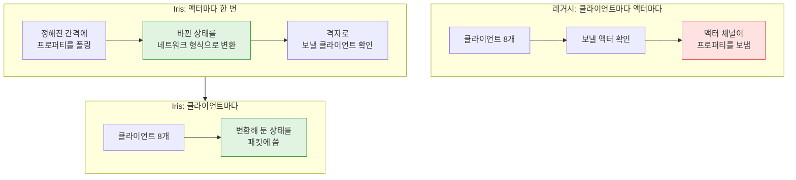
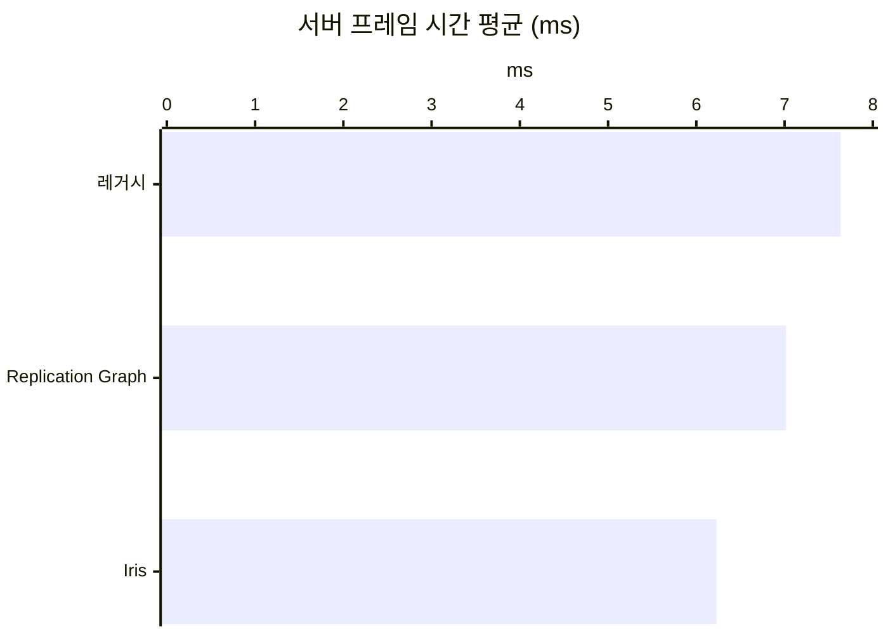

# 15. 레거시 리플리케이션을 Iris로 바꾸기

## 요약

레거시 리플리케이션을 Iris로 바꾸자 서버 프레임 시간이 18.4% 줄었다. Iris는 언리얼 엔진의 새 리플리케이션 시스템이다. 레거시는 엔진의 기본 리플리케이션 방식이다. 서버 프레임 시간은 서버가 한 프레임을 처리한 시간이다.

연결당 송신 대역폭은 3.25% 늘었다. 연결은 서버와 클라이언트 하나 사이의 통신이다. 화면 속 NPC의 움직임은 레거시와 구별되지 않았다.

| 지표 | 지금 구성 | Iris로 바꾼 뒤 | 변화 |
| --- | --- | --- | --- |
| 서버 프레임 시간 평균 | 7.64ms | 6.23ms | -18.4% |
| 리플리케이션 시간 | 3.35ms | 1.89ms | -43.6% |
| 연결당 송신 대역폭 | 9,790바이트/초 | 10,100바이트/초 | +3.25% |
| 1번 클라이언트에 존재하는 자원 노드 | 176개 | 112개 | -64개 |

| 레거시 | Iris |
| --- | --- |
|  |  |

1번 클라이언트가 위에서 내려다본 화면이다. 초록 점이 이 클라이언트에 존재하는 자원 노드다. Iris는 150m 밖으로 벗어난 자원 노드를 클라이언트에서 지운다.

리플리케이션 시간은 서버 프레임 시간 가운데 액터를 확인하고 보낸 시간이다. 수치는 구성마다 세 번 실행한 중앙값이다. 실행별 값, 계산식, 엔진 소스 위치는 [측정 기록](measurements.md)에 있다.

## 문제: 서버가 클라이언트마다 액터를 하나씩 보낸다

지금 구성의 서버는 클라이언트마다 액터를 하나씩 보낸다. 레거시는 클라이언트마다 액터 채널을 두고, 액터 채널마다 액터를 보낸다. 액터 채널은 서버가 액터 하나를 클라이언트 하나에 보내는 통로다.

[Replication Graph로 바꾸기](../14-replication-graph/README.md)는 확인하는 일을 줄였다. 그래도 보내는 일은 그대로였다. 같은 시각에 잰 두 구성의 리플리케이션 시간이다.

| 리플리케이션 시간(프레임당) | 레거시 | Replication Graph |
| --- | ---: | ---: |
| 확인하는 일 | 2.00ms | 1.05ms |
| 보내는 일 | 1.35ms | 1.61ms |

보내는 일은 액터 채널이 액터를 보낸 시간이다. 레거시의 액터 채널은 프레임마다 약 183번 액터를 보냈다. 서버가 클라이언트 8개에 같은 NPC와 캐릭터를 따로 보내기 때문이다.

## 원리: 상태를 한 번 변환해 두고 클라이언트마다 패킷에 쓰기만 한다

Iris에는 액터 채널이 없다. Iris는 액터의 상태를 프레임에 한 번 네트워크 형식으로 변환해 둔다. 그리고 클라이언트마다 변환해 둔 상태를 패킷에 쓰기만 한다.



빨간 칸이 Iris가 없앤 일이다. 초록 칸이 그 일을 나눈 두 단계다. 폴링은 서버가 액터의 프로퍼티를 읽어 바뀌었는지 보는 일이다.

비교를 위해 Iris의 기본 동작 세 가지를 레거시에 맞췄다.

- **폴링 간격**: 레거시가 확인하는 평균 간격에 맞췄다. NPC는 4프레임, 자원 노드는 16프레임이다. 엔진 그대로면 NPC를 3프레임마다 폴링한다.
- **우선순위**: 거리와 상관없이 1.0으로 두었다. 엔진 그대로면 먼 액터를 늦게 보낸다.
- **NPC 이동 구조체**: Iris가 `NetSerialize`가 쓴 비트를 그대로 보내게 등록했다. 등록하지 않으면 Iris는 이 함수를 부르지 않는다.

**예상.** 액터 채널로 보내는 약 183번이 클라이언트마다 쓰는 8번이 된다. 그래서 보내는 일 1.35ms의 대부분이 줄 것이다. 캐릭터는 매 프레임 폴링하므로 대역폭은 Replication Graph처럼 약 6.8% 늘 것이다.

## 적용: 실행 인자로 Iris를 켠다

```diff
 // DSOptLab.uproject
+	{ "Name": "Iris", "Enabled": true }

 // Source/DSOptLab/DSOptLab.Build.cs
+	SetupIrisSupport(Target);

 // Source/DSOptLab/LabNpc.cpp
+UE_NET_IMPLEMENT_NAMED_STRUCT_LASTRESORT_NETSERIALIZER_AND_REGISTRY_DELEGATES(LabNpcMove);

 // Source/DSOptLab/LabGameMode.cpp (Iris일 때만)
+	// 레거시의 평균 간격 P = (30 ÷ 빈도) + 1프레임에 맞춘다.
+	const int32 PeriodFrames = FMath::RoundToInt(TickRate / LegacyFrequency + 1.f);
+	Actor->SetNetUpdateFrequency(TickRate / (PeriodFrames + 0.5f));
```

`SetupIrisSupport`가 없으면 Iris는 인벤토리의 FastArray를 보내지 않는다. 표의 인자는 측정 스크립트(`Scripts/run-scenario.ps1`)의 인자다.

| 구성 | 더한 실행 인자 |
| --- | --- |
| 레거시(지금 구성) | 없음 |
| Replication Graph | `-ReplicationGraph` |
| Iris | `-Iris -IrisFlatPriority` |
| Iris, 기본 우선순위 | `-Iris` |

`-Iris`는 서버와 클라이언트에 엔진 인자 `-UseIrisReplication=1`을 준다. 모든 구성은 [NPC 이동을 필요한 비트만 담은 구조체로 보내기](../12-npc-move-netserialize/README.md)의 인자를 그대로 쓴다. 네 구성을 세 번씩 연달아 쟀다. 이 시점의 코드는 태그 [`post-15-iris`](https://github.com/hon454/ue-dedicated-server-optimization-lab/tree/post-15-iris)에 있다.

## 결과: 보내는 일이 줄어 서버 프레임 시간이 18.4% 줄었다

### 예상과 실제

| 항목 | 예상 | 실제 |
| --- | --- | --- |
| 보내는 일(프레임당) | 1.35ms의 대부분이 준다 | 0.404ms로 줄었다 |
| 연결당 송신 대역폭 | 약 6.8% 는다 | 3.25% 늘었다 |

대역폭이 예상보다 덜 늘어난 이유는 확인하지 않았다.

### 세 시스템 가운데 Iris가 가장 빠르다

같은 설정에서 Iris의 서버 프레임 시간은 Replication Graph보다 11.2% 짧았다.

| 구성 | 서버 프레임 시간 평균 | 확인하는 일 | 보내는 일 |
| --- | ---: | ---: | ---: |
| 레거시(지금 구성) | 7.64ms | 2.00ms | 1.35ms |
| Replication Graph | 7.02ms | 1.05ms | 1.61ms |
| Iris | 6.23ms | 1.48ms | 0.404ms |



Iris는 상태를 변환하는 일을 확인하는 단계로 옮겼다. 그래서 확인하는 일은 Replication Graph보다 길다. 대신 보내는 일은 레거시의 30.0%로 줄었다.

- **확인하는 일**: Iris에서는 폴링, 상태 변환, 격자로 확인하기, 우선순위가 여기에 든다. 넷 드라이버의 나머지 일도 든다. 가장 큰 것은 클라이언트마다 격자로 확인하는 일로, 프레임당 0.377ms다.
- **보내는 일**: Iris에서는 클라이언트마다 패킷에 쓰는 시간이다. 클라이언트 8개에 프레임마다 한 번씩 쓴다.

> **Iris의 기본 우선순위는 먼 NPC를 늦게 보낸다**
>
> 엔진 그대로의 Iris는 송신 대역폭을 9.28% 줄였다. 대신 화면 속 NPC가 끊겼다. Iris는 다음 순서로 보낼 액터를 고른다.
>
> 1. 서버가 액터마다 시점과의 거리로 우선순위를 준다. 20m 안의 액터는 1.0을 받는다. 100m 밖의 액터는 0.1을 받는다.
> 2. 서버가 바뀐 액터의 우선순위를 프레임마다 더한다.
> 3. 서버가 더한 값이 1.0 이상인 액터만 보낸다.
>
> 그래서 100m 밖의 NPC는 10프레임마다 간다. 표시 속도 오차가 초당 15.0cm에서 98.6cm로 늘었다. 표시 속도 오차는 화면 속 NPC의 속도가 서버의 속도와 다른 정도다. 서버 프레임 시간은 구별되지 않았다.
>
> 
>
> 엔진 그대로의 Iris에서 10초 동안 찍은 화면이다. 왼쪽 화면에서 무리 밖의 빨간 점이 먼 NPC다. 먼 NPC는 띄엄띄엄 움직인다.

### 화면 속 NPC는 그대로다

화면 속 NPC의 움직임을 재는 두 지표(표시 위치 오차, 표시 지연)는 세 구성에서 구별되지 않았다. 처음 잰 묶음에서는 Iris의 일부 클라이언트에서 NPC가 멈췄다.

> **Iris는 새로 보낼 액터를 오래된 상태로 보낸다**
>
> Iris는 어느 클라이언트에도 보내지 않는 액터를 폴링하지 않는다. 그 액터가 다시 보낼 대상이 되면 마지막으로 폴링한 상태로 간다. 그 상태에 든 서버 프레임 번호도 오래되었다.
>
> 클라이언트는 이 번호로 NPC를 그리는 시계를 맞춘다. 오래된 번호가 앞선 번호로 읽히면 시계가 최대 약 4초 당겨진다. 그동안 클라이언트의 NPC가 멈췄다.
>
> 클라이언트가 NPC의 첫 상태를 시계 계산에서 빼게 고쳤다. 위의 수치는 모두 고친 뒤에 잰 값이다.

## 배운 것과 한계

- **Iris는 보내는 구조를 바꾼다.** Replication Graph는 확인할 액터를 줄였다. Iris는 상태를 한 번 변환해 두고 클라이언트마다 쓰기만 해서 보내는 일을 줄였다.
- **Iris의 기본값은 레거시와 다르다.** 폴링 간격, 거리 우선순위, 구조체의 `NetSerialize`, FastArray의 빌드 설정이 다르다. 바꾸기 전에 이 목록을 확인해야 같은 화면을 얻는다.
- **첫 상태를 믿지 않아야 한다.** Iris에서는 새로 보낼 액터의 첫 상태가 폴링 간격보다 오래될 수 있다.

Iris에서는 열린 액터 채널 수와 송신 한도 포화 비율을 재지 못했다. 측정 환경의 한계는 [테스트베드와 측정 방법](../00-testbed/README.md)의 "한계"에 있다.

**다음.** 2막에서 계획한 포스팅은 여기까지다. 루트 README의 결과는 지금까지의 모든 구성을 한 번에 다시 재서 갱신한다. 레거시, Replication Graph, Iris는 거기서 나란히 비교한다.
